# 하루한칸

하루 10분, 오늘 공부한 것을 한 칸씩 채워 학습 습관이 끊기지 않게 하는 서비스의 소개 페이지입니다.

- 배포 주소: https://kimcumjee.github.io/uiuxprogramming/
- 저장소: https://github.com/kimcumjee/uiuxprogramming

## 중간고사 · 새로 추가한 기능: 이번 주 기록 보기

7주차 흐름의 끝인 기록 완료 화면에서 [이번 주 기록 보기]를 누르면 최근 7일 기록 칸과 연속 일수가 열립니다.
사용자는 방금 채운 오늘 칸을 확인한 뒤 날짜별 기록을 열어 보고, 과목으로 찾고, 잘못 남긴 기록을 지울 수 있습니다.

**왜 이 기능인가.** 이 서비스의 목적은 "매일 했다는 사실을 눈으로 보여 주는 것"입니다.
7주차에는 기록을 남기는 데서 흐름이 끝나 채운 칸을 볼 방법이 없었습니다.
기록 직후가 성취감이 가장 큰 순간이므로, 흐름의 **끝**에 이어 붙였습니다.

### 연결된 사용자 흐름

```
(7주차) 안내 확인 → 1 과목·시간 → 2 집중도 → 3 확인 → 기록 완료
                                                    ↓ [이번 주 기록 보기]
(새 경로) 이번 주 기록 ─ 최근 7일 칸 + 연속 일수, 오늘 칸이 채워지는 효과
            ├─ 칸 선택     → 그날 기록 목록 / 기록 없음 안내
            ├─ 과목으로 찾기 → 일치 칸 강조 + 합계 / 빈 값 오류 / 결과 없음
            ├─ 지우기      → 확인 상자 → [네, 지우기] 또는 [취소]
            └─ 새 기록 더하기 → 7주차 흐름을 초기화하고 1단계부터 다시 시작
```

### 사용자 행동 · 조건 · 반응

| 사용자 행동 | 이벤트 · 확인할 조건 | 성공 반응 | 다른 분기의 반응 | 다음 행동 |
| --- | --- | --- | --- | --- |
| 완료 화면에서 [이번 주 기록 보기] | `click` · 오늘 기록이 저장되었는가 | 7칸 보드가 열리고 오늘 칸이 채워지는 효과, "4일 연속으로 칸을 채우고 있습니다", 오늘 기록이 펼쳐짐 | 오늘 칸이 비어 있으면 "오늘 기록하면 N일 연속이 됩니다" 로 기다리는 색 표시 | 칸 선택, 과목 찾기 |
| 날짜 칸을 누른다 | `click` · 그날 기록이 있는가 | 그날 기록을 `과목 · 시간 · 집중도` 한 줄씩 보여 주고 각 줄에 [지우기] | **결과 없음:** "이 날은 기록이 없습니다. 하루 빠져도 지금까지 채운 칸은 그대로 남습니다." (오늘이면 [새 기록 더하기]로 안내) | 다른 칸 선택, 지우기 |
| 과목 이름을 넣고 [찾기] / Enter | `submit` · 값이 비었는가 → 일치하는 기록이 있는가 (대소문자 무시, 부분 일치) | 일치한 칸만 노란 테두리로 강조하고 나머지는 흐리게, "'자료' 기록 4개 · 총 280분" | **오류:** 빈 값이면 "찾을 과목 이름을 입력해 주세요. 예: 자료구조", 입력창 빨간 테두리와 포커스 / **결과 없음:** "'수학' 기록이 이번 주에 없습니다. 과목 이름을 확인하거나 [검색 지우기]…" | 강조된 칸 열기, [검색 지우기] |
| 검색창에 다시 입력한다 | `input` · 오류가 표시 중인가 | 오류 문구와 빨간 테두리를 지움 | — | 다시 찾기 |
| 기록 줄의 [지우기] | `click` · 바로 지우지 않고 확인 상자를 연다 | "'자료구조 · 90분 · 집중도 좋음' 기록을 지울까요?" 와 함께 포커스를 안전한 [취소]에 둠 | — | [네, 지우기] 또는 [취소] |
| [네, 지우기] | `click` · 확인 중인 기록이 있는가 | 기록을 지우고 칸·연속 일수·검색 결과를 다시 계산, "기록을 지웠습니다." | 오늘 기록을 지우면 연속 일수가 "오늘 칸이 비어 있습니다…" 로 바뀜 | 다른 칸 보기, 새 기록 더하기 |
| [취소] | `click` | — | **취소:** 확인 상자를 닫고 "지우기를 취소했습니다. 기록은 그대로 남아 있습니다." | 계속 보기 |
| [새 기록 더하기] | `click` | 7주차 흐름을 처음 상태로 초기화하고 1단계 과목 칸에 포커스 | 완료하면 보드가 열린 채로 오늘 칸이 바로 갱신됨 | 기록 남기기 |

### 상태 유지와 초기화

- 다른 칸을 열어도 **검색어와 강조는 유지**됩니다. 찾은 칸을 차례로 열어 볼 수 있습니다.
- 다른 칸을 열면 진행 중이던 지우기 확인은 닫힙니다. 다른 날 기록이 지워지는 실수를 막습니다.
- 검색 중에 기록을 지우면 남은 기록으로 검색 결과를 다시 계산합니다. 마지막 일치 기록을 지우면 결과 없음으로 바뀝니다.
- [새 기록 더하기]는 7주차의 [다시 기록하기]와 같은 `resetRecordFlow()` 함수를 써서 입력·오류·선택·진행 상태를 모두 비웁니다.
- 프로토타입이므로 지난 6일 기록은 예시 데이터이고, 4일 전은 일부러 비워 연속 일수가 끊기는 경우를 볼 수 있게 했습니다. 새로고침하면 예시 상태로 돌아갑니다.

### 코드에서 바꾼 곳

| 파일 | 내용 |
| --- | --- |
| `index.html` | 완료 화면에 [이번 주 기록 보기] 버튼, `#weekBoard` 섹션(연속 일수, 7칸 목록, 검색 폼, 날짜 상세, 지우기 확인 상자) 추가 |
| `style.css` | 칸 상태 클래스(`is-filled` · `is-today` · `is-selected` · `is-match` · `just-filled`), 검색 메시지 상태(`is-error` · `is-empty` · `is-found`), 위험 버튼, 어두운 테마, 768px 이하 배치 |
| `script.js` | 완료 시 `saveTodayRecord()` 로 기록 저장, 다시 시작을 `resetRecordFlow()` 함수로 분리, 칸 그리기·연속 일수·검색·지우기 확인 로직 추가 |

HTML 은 빈 구조만 두고, 칸과 기록 목록은 JavaScript 가 데이터로 다시 그리며, 보이는 모양은 CSS 클래스가 담당합니다.
사용자가 입력한 과목명은 `innerHTML` 이 아니라 `textContent` 로 넣었습니다.

### 접근성

- 각 칸은 `button` 이고 `aria-label` 로 "10월 21일 (수), 기록 2개, 찾은 과목 있음" 처럼 읽힙니다. 선택 상태는 `aria-pressed` 로 전달합니다.
- 칸을 다시 그린 뒤에도 누른 칸으로 포커스를 되돌려 키보드 위치를 잃지 않게 했습니다.
- 연속 일수·검색 결과·지우기 결과는 `aria-live="polite"` 로 읽힙니다.
- 오늘 칸 강조 효과는 `prefers-reduced-motion` 에서 끕니다.

### 중간고사 테스트 결과

로컬 서버에서 실제 브라우저로 조작해 확인했습니다. (2026-10-22)

| 확인 경로 | 조작 | 결과 |
| --- | --- | --- |
| 정상 | 안내 확인 → 자료구조 90분 → 완료 → 이번 주 기록 보기 | 오늘 칸 `기록 1개` 로 채워짐, "4일 연속으로 칸을 채우고 있습니다", 오늘 기록 펼쳐짐 |
| 결과 없음 (날짜) | 4일 전 빈 칸 선택 | "이 날은 기록이 없습니다…" 표시, 포커스는 누른 칸에 유지 |
| 오류 (검색) | 공백만 넣고 찾기 | 오류 문구, 입력창 빨간 테두리, 입력창으로 포커스 → 다시 입력하면 오류 해제 |
| 결과 없음 (검색) | `수학` 찾기 | 결과 없음 안내와 [검색 지우기] 표시, 칸은 흐려지지 않음 |
| 성공 (검색) | `자료` 찾기 → 다른 칸 선택 | 4칸 강조, "기록 4개 · 총 280분", 칸을 옮겨도 검색 유지 |
| 취소 | 오늘 기록 [지우기] → [취소] | 확인 상자가 닫히고 기록 1개 그대로, 취소 안내 표시 |
| 삭제 | 오늘 기록 [지우기] → [네, 지우기] | 오늘 칸이 빈 칸으로, 연속 일수 "오늘 기록하면 4일 연속이 됩니다", 검색 결과 3개 · 190분으로 재계산 |
| 다시 시작 | [새 기록 더하기] → 영어 30분 완료 | 1단계·빈 입력으로 초기화, 완료 즉시 오늘 칸과 연속 일수 갱신 |
| 반응형 | 1280px · 768px · 390px 에서 같은 경로 | 가로 스크롤 없음, 화면 밖으로 나간 요소 0개, 7칸이 한 줄 유지, 검색 버튼은 모바일에서 세로 배치 |
| Console | 로드와 전 경로 조작 | 오류 없음 |

테스트 중 고친 문제: 지우기 후 새 기록을 완료하면 "기록을 지웠습니다" 문구가 남아 있어, 기록 저장 시 이전 안내를 지우도록 수정했습니다.

| 기록 보드 | 과목 검색 | 결과 없음 |
| --- | --- | --- |
| 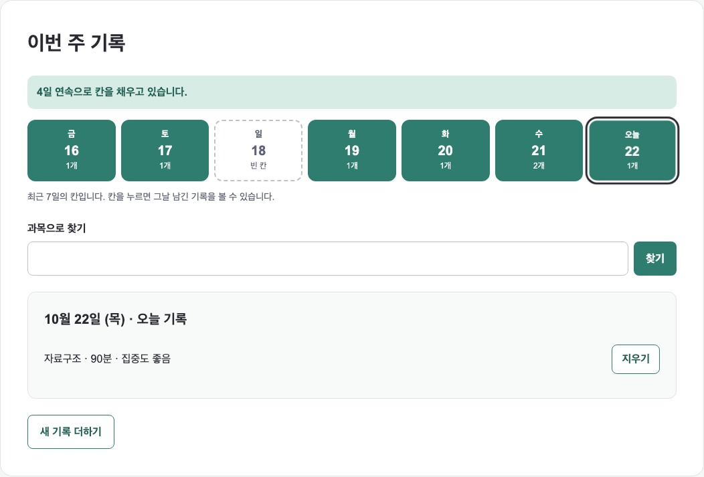 | 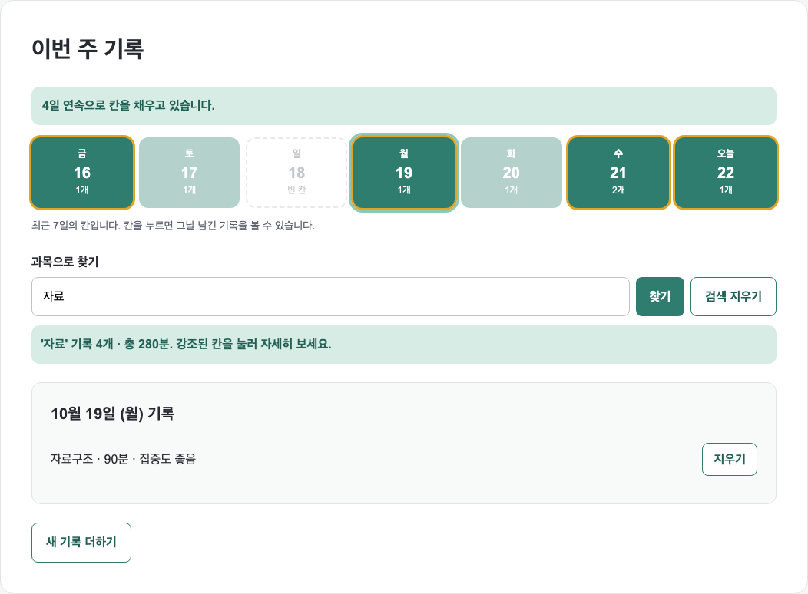 | 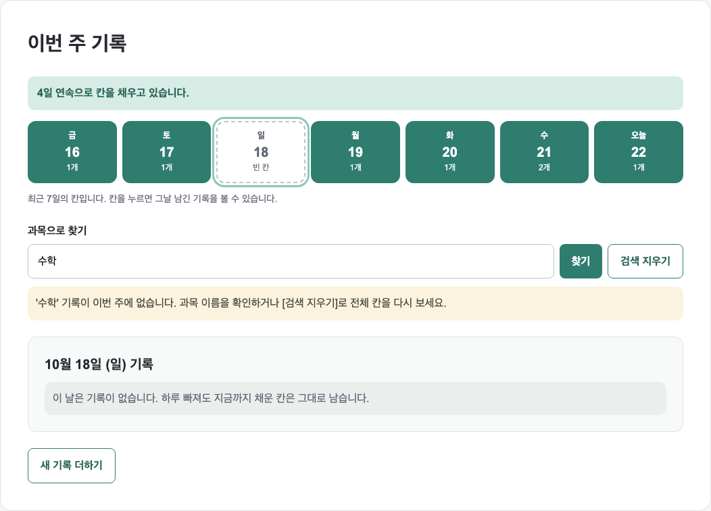 |

| 지우기 확인 | 모바일 390px · 어두운 테마 · 빈 검색 오류 |
| --- | --- |
| 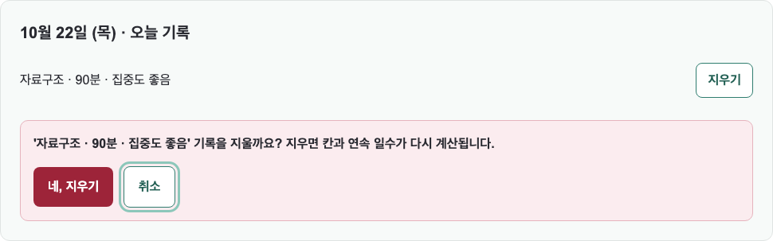 | 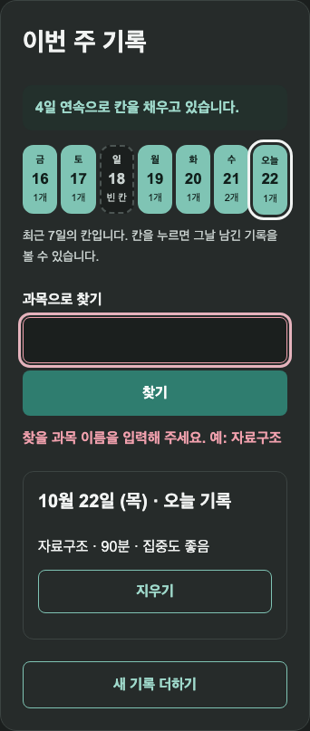 |

## 12주차 UI 컴포넌트와 반복 가능한 인터페이스

버튼과 선택 요소의 공통 규칙을 토큰으로 정리했습니다. 탐색은 화면 폭에 맞게 배치하고, 저장된 기록 한 건으로 카드 한 장을 만들었습니다.

### 1. 선택한 반복 UI와 사용하는 사람의 행동

| 반복 UI | 사용자의 행동 |
| --- | --- |
| **기록 카드** (이번 주 기록 → 기록 모아 보기) | 지난 기록을 훑어보고, 그날 칸을 열어 보거나, 잘못 남긴 기록을 지운다 |
| **선택 카드** (집중도 · 공부 방식) | 기록 2단계에서 오늘의 집중도와 공부 방식을 고른다 |
| **버튼** (주요 · 보조 · 위험 · 필터 · 메뉴) | 다음 단계로 가기, 저장, 지우기, 범위 고르기, 메뉴 열기 |

기록 카드는 `createRecordCard(record)` 가 기록 한 건을 받아 `li` 카드 한 장을 돌려줍니다.
`renderRecordList()` 는 필터 범위·개수·결과 없음만 정하고, 반복문은 세 줄로 줄었습니다.

```js
visibleRecords.forEach(function (record) {
  recordList.append(createRecordCard(record));
});
```

카드의 두 버튼은 카드마다 이벤트를 붙이지 않습니다. 목록 하나에서 `data-action`(open / delete)과 `data-id` 로 행동을 나눕니다.
`if (button.dataset.action !== "delete") return;` 으로, 나중에 다른 버튼이 생겨도 지우기가 잘못 실행되지 않게 했습니다.

### 2. 공통으로 맞춘 것과 상태에 따라 달라지는 것

**디자인 토큰.** 흩어져 있던 색 값을 `:root` 의 역할 이름으로 바꿨습니다. `--brand` 는 20곳, `--muted` 는 12곳에서 쓰던 같은 값입니다.
어두운 테마는 `body.dark` 에서 같은 이름에 어두운 값을 넣습니다. 새로 만든 카드와 선택 카드는 어두운 테마용 규칙을 따로 쓰지 않았는데도 어두운 색으로 바뀝니다.

| 토큰 | 밝은 테마 | 어두운 테마 | 역할 |
| --- | --- | --- | --- |
| `--brand` | `#2f7d6f` | 같음 | 주요 행동 바탕, 선택 테두리 |
| `--brand-strong` | `#236054` | `#9fd9cb` | 강조 글자 |
| `--brand-soft` | `#d8ece6` | `#23302c` | 강조 바탕, 고른 선택 카드 |
| `--surface` / `--surface-soft` | `#ffffff` / `#f7faf9` | `#262b2a` / `#1f2423` | 카드 바탕 |
| `--ink` / `--muted` | `#292a31` / `#5e6272` | `#f1f3f2` / `#b9c0be` | 글자 / 보조 글자 |
| `--focus` | `#8cc7ba` | `#7fc4b4` | 키보드 초점선 |
| `--danger` / `--danger-bg` | `#9d2439` | `#f0a0ad` / 같음 | 오류·지우기 글자 / 흰 글자를 올리는 빨간 바탕 |
| `--control-height` | `48px` | | 버튼·선택 카드 최소 높이 |

밝은 테마의 진한 초록 `#236054` 는 글자로도, 버튼 hover 바탕(흰 글자)으로도 쓰였습니다.
하나의 토큰으로 묶으면 어두운 테마에서 hover 바탕이 밝은 민트가 되어 흰 글자가 안 보입니다. 그래서 `--brand-hover` 를 따로 두고 값을 바꾸지 않았습니다. 빨간 지우기 버튼도 같은 이유로 `--danger-bg` 를 분리했습니다.

**버튼.** 기본·변형·상태를 나눴습니다.

- **함께 쓰는 규칙:** 다섯 종류 버튼이 높이 48px, 모서리, 글자 굵기를 공유합니다.
- **변형:** 주요(초록 바탕), 보조(초록 테두리), 위험(빨간 바탕), 보조+`danger-text`(카드의 [지우기], 빨간 테두리와 글자)로 나눴습니다.
- **초점:** 버튼마다 따로 있던 `:focus` 규칙 다섯 개를 `:focus-visible` 하나로 합쳤습니다. Tab 으로 도착하면 같은 초점선이 보이고, 마우스로 누를 때는 그리지 않습니다.

**선택 카드.** 집중도는 `select` 에서 라디오 세 장의 선택 카드로 바꿨습니다. 공부 방식 라디오도 같은 컴포넌트의 작은 변형(`choice-list-compact`)으로 바꿨습니다.

| 상태 | 모양 |
| --- | --- |
| 고른 값 (`:checked`) | 초록 테두리 + 안쪽 선 + 옅은 초록 바탕 + **채운 동그라미** |
| 키보드 위치 (`:focus-visible`) | 카드 바깥의 3px 초점선 |
| 기본 | 회색 테두리 + 빈 동그라미 |

선택 표시와 초점선을 다른 모양으로 그렸습니다. Tab 으로 그룹을 벗어나면 초점선만 다음 요소로 가고, 고른 카드의 표시는 남습니다.
동그라미로 선택 여부를 보여 주므로 색을 구분하지 못해도 선택값을 알 수 있습니다.

**기록 카드의 상태.** 저장된 기록의 집중도 값으로 클래스·라벨 문구·모양·덧붙는 문장을 함께 정합니다.

| 집중도 | 클래스 | 라벨 | 모양 | 덧붙는 문장 |
| --- | --- | --- | --- | --- |
| 좋음 | `is-good` | 집중 좋음 | 초록 윗선, 초록 라벨 | 없음 |
| 보통 | `is-normal` | 집중 보통 | 회색 윗선, 테두리 라벨 | 없음 |
| 아쉬움 | `is-low` | 집중 아쉬움 | **점선** 윗선, 노란 라벨, 옅은 바탕 | "다음에는 30분씩 나눠서 기록해 보세요." |

항목마다 다른 값은 과목, 날짜, 시간, 공부 방식입니다. 날짜는 `<time datetime="2026-11-21">오늘 · 11월 21일 (토)</time>` 처럼, 화면에는 읽기 쉬운 날짜를 쓰고 `datetime` 에는 기계가 읽는 날짜를 둡니다.

### 반응형 탐색

같은 세 링크(`#about` · `#recordFlow` · `#weekBoard`)를 화면 폭에 따라 다르게 배치합니다.

| 화면 폭 | 배치 |
| --- | --- |
| 901px 이상 | 왼쪽 250px 고정 탐색: 서비스 이름 → [＋ 오늘 기록하기] → 메뉴. 현재 메뉴는 진한 바탕 + 왼쪽 연두 선 + 굵기·밑줄 |
| 900px 이하 | 상단 바 + [메뉴 열기] 접이식 메뉴 (10주차의 600px 기준을 900px 로 넓힘) |

- 교안은 601~900px 규칙을 따로 추가하지만, 하루한칸의 600px 이하 규칙은 메뉴 규칙만 담고 있었습니다. 그래서 같은 규칙의 기준만 900px 로 바꿔 중복을 만들지 않았습니다.
- 메뉴 링크의 `aria-current` 값을 `page` 에서 `location` 으로 바꿨습니다. 한 페이지 안의 본문 위치를 가리키기 때문입니다. CSS 와 탭 제목 코드도 같이 바꿨습니다.
- [＋ 오늘 기록하기]의 ＋ 는 `aria-hidden="true"` 로 읽지 않게 했습니다. 안내를 확인하기 전에 누르면 10주차의 시작 조건 안내로 이동합니다.
- 본문은 탐색 오른쪽에서 남은 폭의 가운데에 놓입니다. 왼쪽 탐색에서는 상단 바가 없으므로 메뉴로 도착한 제목 위 여백을 80px 에서 24px 로 줄였습니다.

### 3. 넓은 화면과 좁은 화면에서 직접 조작한 결과

로컬 서버에서 실제 Chromium 으로 조작해 확인했습니다. (2026-11-21)

| 확인 | 조작 | 결과 |
| --- | --- | --- |
| 왼쪽 탐색 | 1280px · 901px | 탐색 250px, 본문은 250px 부터 시작해 겹치지 않음, 메뉴 버튼 숨김 |
| 현재 메뉴 | 오늘 기록 → 이번 주 기록 클릭 | 주소·탭 제목·`aria-current="location"`·연두 선이 함께 이동, 제목이 화면 위 24px 에 도착 |
| 접이식 전환 | 900px · 700px · 600px · 375px | 메뉴 버튼 표시 → 열기("메뉴 닫기", `true`) → 링크 선택 시 이동하고 접힘 → Esc 로 닫히고 버튼에 초점 |
| 선택 카드 마우스 | 보통 → 아쉬움 클릭 | 선택 표시가 고른 카드로 옮겨가고 아쉬움 안내가 나타남 |
| 선택 카드 키보드 | Tab 으로 그룹 진입 → ↑ ↑ → Tab | 선택과 초점선이 아쉬움 → 보통 → 좋음으로 함께 이동 → 그룹을 벗어나면 좋음 선택은 남고 초점선은 공부 방식 체크박스로 |
| 버튼 높이 | 보이는 모든 버튼 | 최소 48px |
| 카드 생성 | 기록 저장 후 이번 주 기록 | 맨 위 카드: `집중 좋음` · `오늘 · 11월 21일 (토)` · 자료구조 · `90분 · 복습·정리`, 집중도별 클래스와 라벨이 7장 모두 일치 |
| 카드 열기 | 세 번째 카드 [이 날 칸 보기] | 그날 칸과 상세가 열리고 그 칸에 초점 |
| **상태 변화: 지우기 → 취소** | 카드 [지우기] Enter → 확인 상자 Enter | [취소]에 초점, "지우기를 취소했습니다." 기록 수 그대로 |
| **상태 변화: 지우기** | 다시 [지우기] → [네, 지우기] | 기록 1개 삭제, 카드 목록 다시 그림, 그날 칸에 초점 |
| 결과 없음 | 아쉬움 기록을 모두 지우고 아쉬움 필터 → [전체 보기] | 전체 5개와 결과 문장, [전체]에 초점 |
| 카드 열 수 | 1280px · 701px / 700px · 375px | 두 열 / 한 열, 버튼은 카드 안에서 한 줄에 나뉨 |
| 선택 카드 열 수 | 601px 이상 / 600px 이하 | 세 장 한 줄 / 한 장씩 |
| 가로 넘침 | 위 모든 폭에서 기록 저장까지 | 가로 스크롤 없음, 화면 밖 요소 0개 |
| 대비 | 밝은·어두운 테마의 보이는 모든 글자를 배경과 비교 | 4.5:1(큰 글자 3:1) 미만 0개 |
| 9~11주차 회귀 | 본문 바로가기, 빈 값 오류, 저장 실패, 초기화 | 모두 그대로. 초기화하면 집중도는 좋음, 공부 방식은 닫힘으로 돌아감 |
| Console | 전 경로 | 오류 없음 |

테스트 중 고친 문제: 어두운 테마에서 카드의 [지우기]가 빨간색이 아니라 다른 보조 버튼과 같은 민트색으로 보였습니다.
기존 `body.dark .secondary-button` 규칙이 우선순위에서 이겼기 때문입니다. 같은 범위의 `body.dark .secondary-button.danger-text` 규칙을 더해 고쳤습니다.

| 넓은 화면 왼쪽 탐색 | 900px 접이식 메뉴 |
| --- | --- |
| 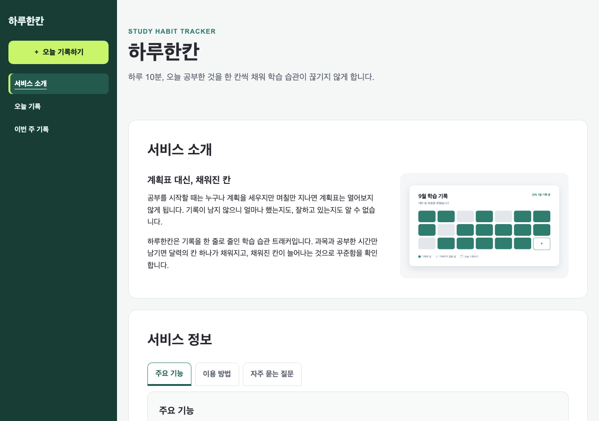 | 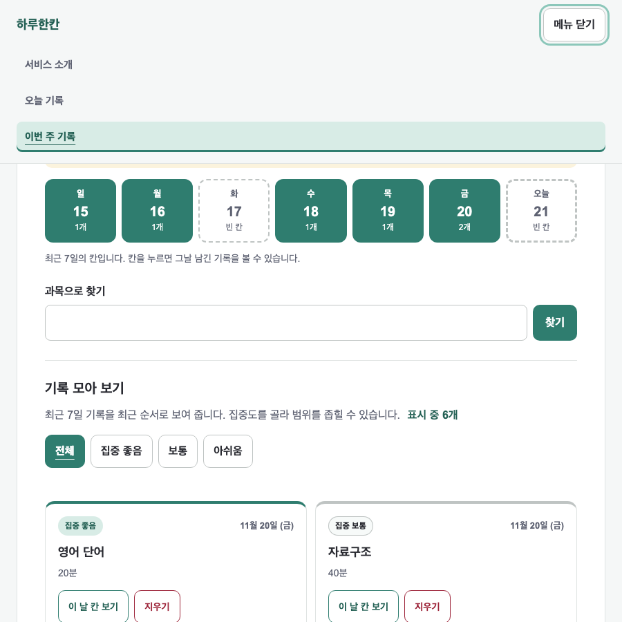 |

| 선택 카드: 키보드 초점 | 선택 카드: 그룹을 벗어난 뒤 | 선택 카드: 어두운 테마 |
| --- | --- | --- |
| 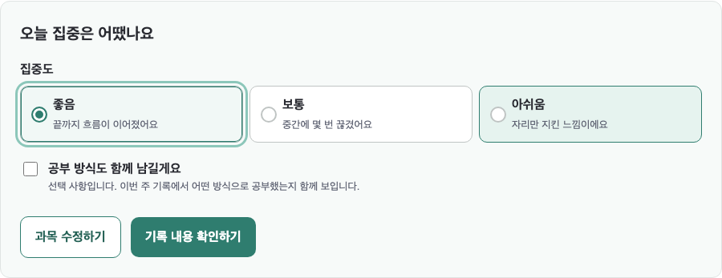 | 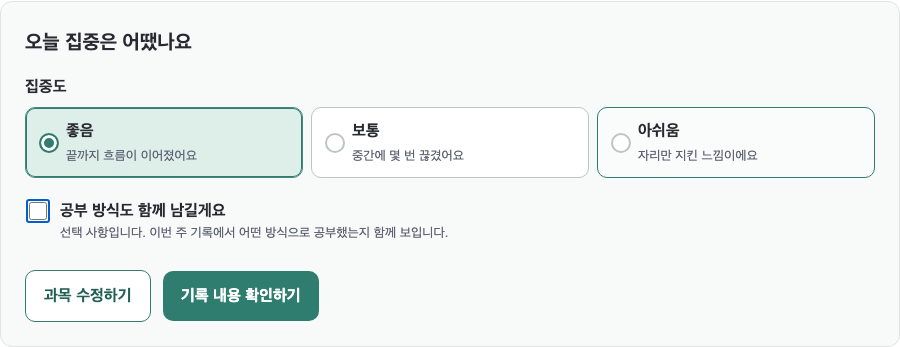 | 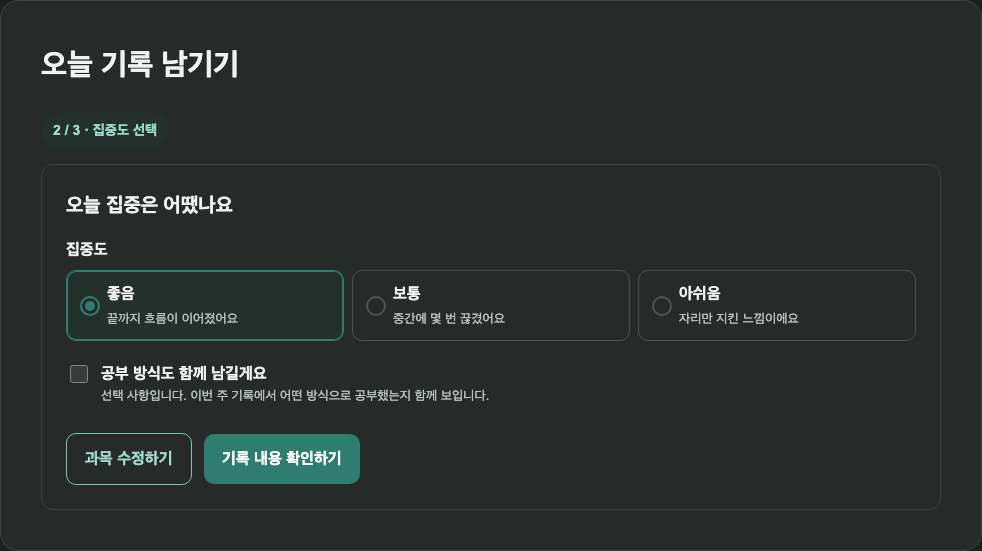 |

| 기록 카드 두 열 | 기록 카드 어두운 테마 | 기록 카드 375px |
| --- | --- | --- |
| 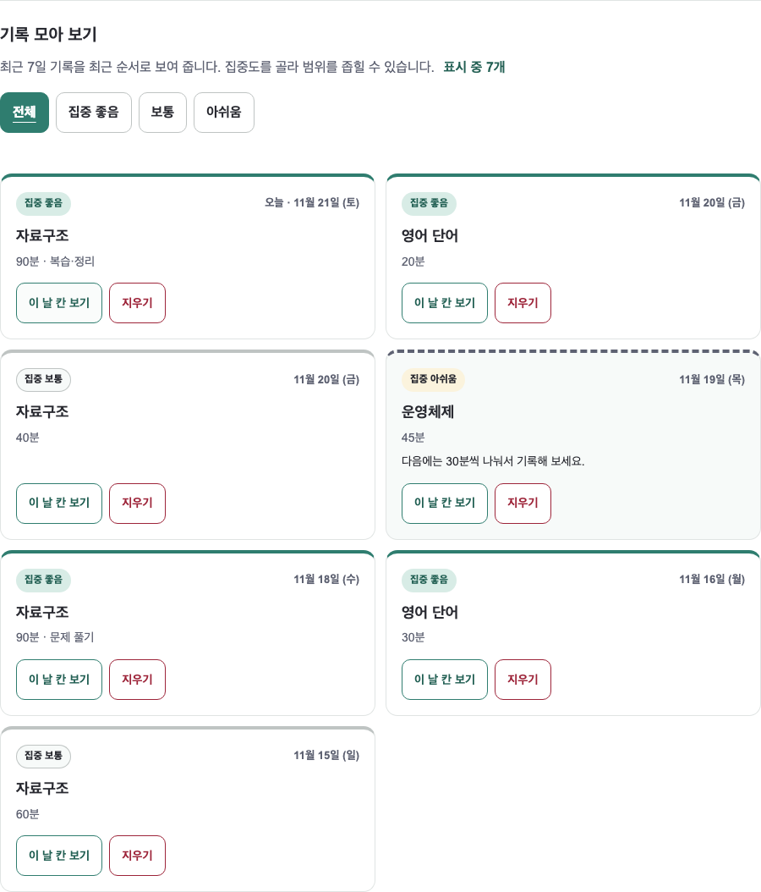 | 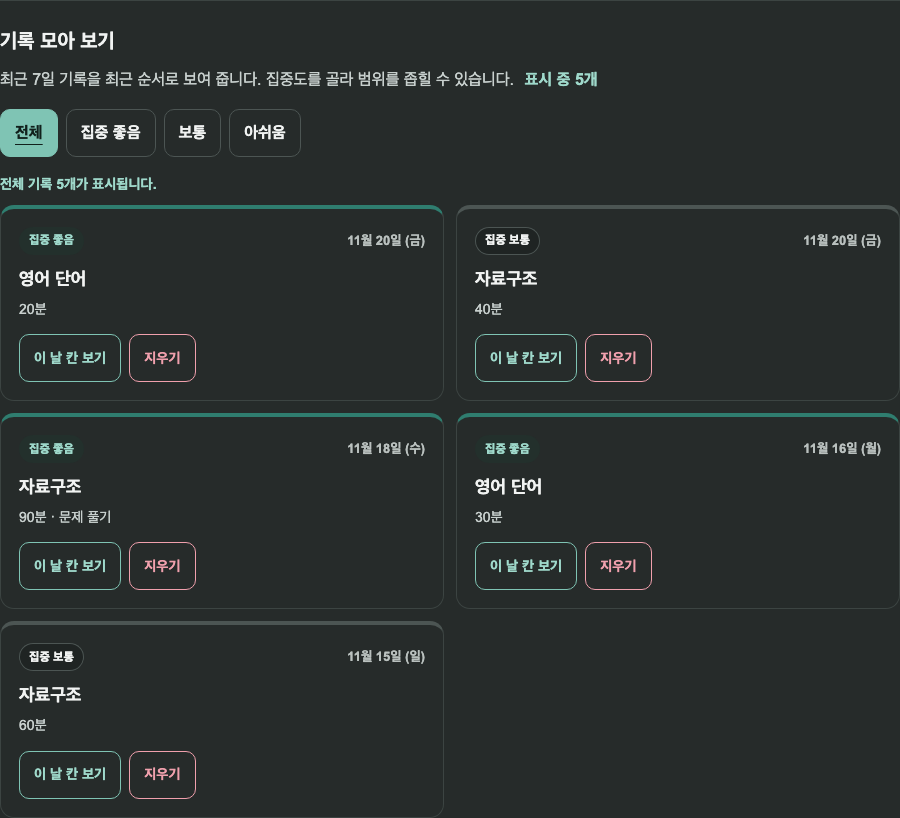 | 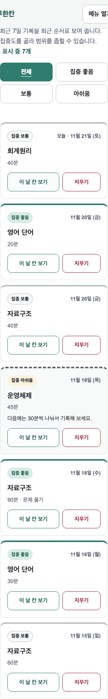 |

### 4. 배포된 웹페이지

https://kimcumjee.github.io/uiuxprogramming/

## 11주차 웹 접근성 개선

10주차까지 만든 화면에서 글자·이미지·메뉴·입력·필터를 **알아볼 수 있는가 → 이해할 수 있는가 → 조작할 수 있는가** 순서로 점검하고 고쳤습니다.

- **개선한 요소:** 현재 메뉴·필터의 굵기와 밑줄, 이미지 설명 수정, 현재 메뉴를 탭 제목에 반영, 글자 수 알림 정리, 본문 바로가기, 필터 결과 알림, 결과 없음에서 [전체 보기]로 복귀
- **정상 경로:** 첫 Tab → [본문 바로가기] Enter → 본문으로 초점 이동 → 안내 확인 → 기록 입력·저장 → [이번 주 기록 보기] → 필터 선택 → "집중 좋음 기록 3개가 표시됩니다." → 기록 열기
- **다른 경로:** 빈 과목·한 글자 과목 오류, 공부 방식 체크 해제, 저장 실패(`?save-error=1`), 필터 결과 없음 → [전체 보기], 기록이 하나도 없음 → [오늘 기록하러 가기], 모바일 메뉴 Esc
- **키보드 확인:** 첫 Tab, Enter·Space, Esc, 지우기 확인과 삭제 뒤 초점 위치
- **모바일 확인:** 600px 와 375px 에서 메뉴·입력·필터 조작, 가로 스크롤 없음
- **배포된 웹페이지:** https://kimcumjee.github.io/uiuxprogramming/

### 실습 01 · 색과 이미지 정보

**대비.** 9·10주차에 새로 생긴 색 조합까지 실제 글자색과 배경색 한 쌍씩 다시 계산했습니다. 모두 일반 글자 기준 4.5:1 을 넘어 색은 바꾸지 않았습니다.

| 글자 / 배경 | 대비 |
| --- | --- |
| 보조 글자 `#5e6272` / 흰 카드 | 6.06:1 |
| 보조 글자 / 기록 단계 배경 `#f7faf9` | 5.77:1 |
| 메뉴 글자 / 상단 바 `#f5f7f7` | 5.63:1 |
| 현재 메뉴 `#236054` / 강조 배경 `#d8ece6` | 5.94:1 |
| 오류 문장 `#9d2439` / 단계 배경 | 7.28:1 |
| 저장 실패 문장 / 실패 배경 `#f8e3e7` | 6.24:1 |
| 선택한 필터 흰 글자 / 초록 `#2f7d6f` | 4.90:1 (가장 낮음) |
| 어두운 테마 보조 글자 `#b9c0be` / 카드 `#262b2a` | 7.76:1 |
| 어두운 테마 선택 필터 `#11201c` / `#7fc4b4` | 8.38:1 |

**색 말고도 선택을 구분합니다.** `aria-current="page"` 인 메뉴와 `aria-pressed="true"` 인 필터에 굵기 800 과 밑줄을 더했습니다.
CSS 가 JavaScript 의 상태값을 그대로 읽으므로, 보이는 선택과 화면 낭독기가 읽는 선택이 항상 같은 대상입니다.

**이미지 설명을 실제 그림에 맞게 고쳤습니다.** 그림의 칸을 다시 세어 보니 채워진 칸은 16칸이었습니다. 기존 alt 에는 "18칸이 채워져 있고" 라고 적혀 있었습니다.
그림 안의 "이번 달 18일을 채웠습니다" 문구를 보고 쓴 숫자였습니다. 그림을 볼 수 없는 사용자에게는 실제로 보이는 칸 수를 전해야 하므로 alt 를 다음처럼 고쳤습니다.

```
9월 학습 기록 달력. 21칸 중 16칸이 진한 초록으로 채워지고 4칸은 비어 있으며,
마지막 오늘 칸은 점선과 더하기 기호로 기록을 기다리고 있다.
```

### 실습 02 · 이름과 상태를 코드에 연결

- **탭 제목:** `updateCurrentNav()` 가 메뉴의 `aria-current` 를 먼저 바꾼 뒤 그 메뉴 이름으로 `document.title` 을 정합니다. 메뉴에 없는 주소(`#top` 등)에서는 `하루한칸` 만 남깁니다.

| 누른 메뉴 | 주소 끝 | 브라우저 탭 제목 |
| --- | --- | --- |
| 서비스 소개 | `#about` | 서비스 소개 \| 하루한칸 |
| 오늘 기록 | `#recordFlow` | 오늘 기록 \| 하루한칸 |
| 이번 주 기록 | `#weekBoard` | 이번 주 기록 \| 하루한칸 |

- **아이콘 버튼 이름:** 교안의 × 닫기 버튼에 해당하는 버튼은 하루한칸에 없습니다. 대신 화면의 모든 `button` · `a` · 입력 요소에 읽히는 이름이 있는지 검사했고, 이름 없는 요소는 0개였습니다. 기록마다 반복되는 [지우기]는 이미 `aria-label="자료구조 기록 지우기"` 처럼 무엇을 지우는지 읽힙니다.
- **글자 수 알림:** 과목 글자 수(`#subject-count`)와 표시 이름 글자 수(`#userNameCount`)에서 `aria-live` 를 뺐습니다. 한 글자 칠 때마다 숫자를 읽지 않게 하고, 입력칸의 `aria-describedby` 연결은 그대로 두었습니다.
- **조건부 입력:** 9주차의 `syncMethodFields()` 가 체크 해제 시 `hidden` 과 `disabled` 를 함께 바꾸는지 확인했습니다. 체크를 풀면 체크박스 다음 Tab 이 바로 [과목 수정하기]로 갑니다.
- **오류와 저장 상태:** 9주차 코드를 다시 실행해 확인했습니다. 빈 과목과 한 글자 과목에서 서로 다른 오류 문장과 과목 칸 초점, 저장 중 `aria-busy="true"` · 버튼 잠금 · "칸을 채우는 중…" 이 함께 바뀝니다.

### 실습 03 · 키보드와 모바일에서 흐름 완성

- **본문 바로가기:** `<body>` 바로 아래에 [본문 바로가기]를 두고 `<main id="top" tabindex="-1">` 로 연결했습니다. 평소에는 화면 위에 숨어 있다가 첫 Tab 에서 왼쪽 위에 나타납니다. 고정 상단 바(`z-index: 10`) 위에 보이도록 `z-index: 20` 을 주었습니다. Enter 를 누르면 본문에 초점이 가고, 다음 Tab 은 메뉴를 건너뛰고 본문의 첫 조작 대상([주요 기능] 탭)으로 갑니다.
- **Esc 로 모바일 메뉴 닫기:** 10주차에 미리 넣어 둔 기능입니다. 메뉴·버튼 문구·`aria-expanded` 가 닫힌 상태로 바뀌고 초점이 [메뉴 열기]로 돌아오는 것을 다시 확인했습니다.
- **필터 결과 알림:** 필터 아래에 `role="status"` · `aria-live="polite"` 문장을 두었습니다. 버튼 문구와 표시 개수로 "집중 좋음 기록 3개가 표시됩니다." 또는 "아쉬움 기록이 없습니다. 다른 조건을 선택하거나 [전체 보기]를 눌러 보세요." 를 알립니다. 기록을 지우거나 새로 저장해 목록이 바뀌면 지난 결과 문장은 맞지 않으므로 비웁니다.
- **지운 뒤 초점:** 교안의 "계획 취소 뒤 초점 유지" 에 해당하는 동작은 하루한칸에서는 기록 지우기입니다. 중간고사 때부터 [지우기]를 누르면 안전한 [취소]로, [네, 지우기] 뒤에는 그날 칸으로 초점이 돌아갑니다. 필터로 걸러 둔 상태에서 키보드로 지워도 초점이 사라지지 않는 것을 확인했습니다.
- **결과 없음에서 [전체 보기]:** 걸러서 비었을 때도 다음 행동 버튼을 숨기지 않고 [전체 보기]로 바꿨습니다. 누르면 전체 필터를 실행하고 [전체] 버튼으로 초점을 옮깁니다. 기록이 하나도 없을 때는 원래대로 [오늘 기록하러 가기]가 오늘 기록으로 이동합니다.

### 11주차 테스트 결과 (최종 확인표)

로컬 서버에서 실제 Chromium 으로, 마우스 없이 키보드 조작을 중심으로 확인했습니다. (2026-11-21)

| 확인 행동 | 조작 | 결과 |
| --- | --- | --- |
| 첫 조작 대상 | 새로고침 직후 Tab → Enter | [본문 바로가기]가 왼쪽 위에 나타남 → 초점이 본문으로, 다음 Tab 은 [주요 기능] 탭 |
| 메뉴 상태 | 세 메뉴 클릭 → 뒤로 두 번 | 주소·밑줄·굵기·`aria-current`·탭 제목이 함께 바뀌고 함께 돌아옴 |
| 조건부 입력 | 공부 방식 Space 로 체크 → 해제 | 라디오로 Tab 이동 → 해제하면 화면과 Tab 순서에서 사라짐 |
| 입력 오류 | 빈 과목 / 한 글자 과목 | 각기 다른 오류 문장, 초점은 과목 칸 |
| 저장 | 저장 버튼에서 Enter | "칸을 채우는 중…" → 완료 제목에 초점, 진행 표시 "기록 완료" |
| 저장 실패 | `?save-error=1` | 실패 문장, 입력값 유지, 버튼 재활성화와 초점 |
| 필터 | 집중 좋음 / 아쉬움 (Enter) | 밑줄·`aria-pressed`·목록·표시 개수·결과 문장이 같은 조건 |
| 키보드 지우기 | 아쉬움 기록 열기 → [지우기] → [네, 지우기] 두 번 | 확인 상자에서 [취소]에 초점 → 지운 뒤 그날 칸에 초점 |
| 결과 없음 | 아쉬움 다시 선택 → Tab 으로 [전체 보기] Enter | 결과 없음 문장 → 전체 5개, "전체 기록 5개가 표시됩니다.", [전체]에 초점 |
| 기록 없음 | 기록을 모두 비움 → [오늘 기록하러 가기] | 주소 `#recordFlow`, 탭 제목 "오늘 기록 \| 하루한칸" |
| 모바일 메뉴 | 600px · 375px 에서 Enter 로 열기 → Tab → Esc → Enter | 메뉴 닫기·`true` → 첫 링크 → 닫히고 버튼으로 초점 → 다시 열림 |
| 모바일 흐름 | 600px · 375px 에서 기록 저장 → 필터 | 가로 스크롤 없음, 화면 밖 요소 0개, 바로가기 링크가 화면 안에 보임 |
| 이름 없는 요소 | 모든 버튼·링크·입력 검사 | 0개 |
| Console | 전 경로 | 오류 없음 |

테스트 중 고친 문제: 결과 없음 안내가 "[전체]를 눌러" 라고 적혀 있어 실제 버튼 이름 [전체 보기]와 달랐습니다. 안내 문장을 버튼 이름에 맞췄습니다.

| 첫 Tab · 본문 바로가기 | 현재 메뉴 굵기·밑줄 |
| --- | --- |
| 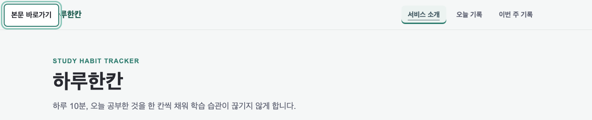 | 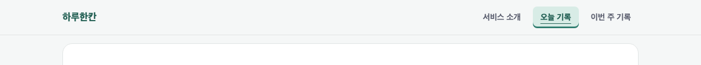 |

| 필터 결과 없음 · 전체 보기 | 전체 보기 뒤 | 모바일 375px |
| --- | --- | --- |
| 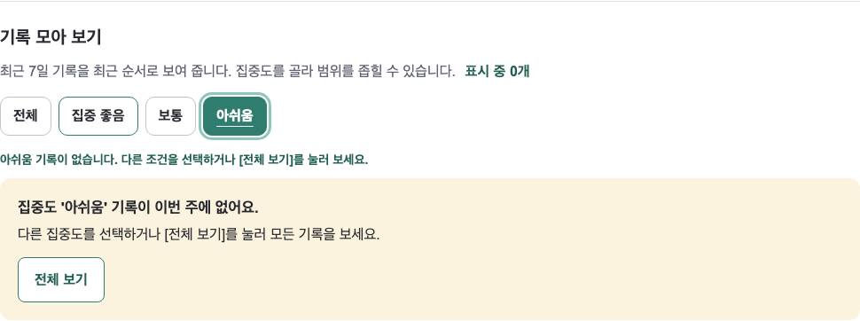 | 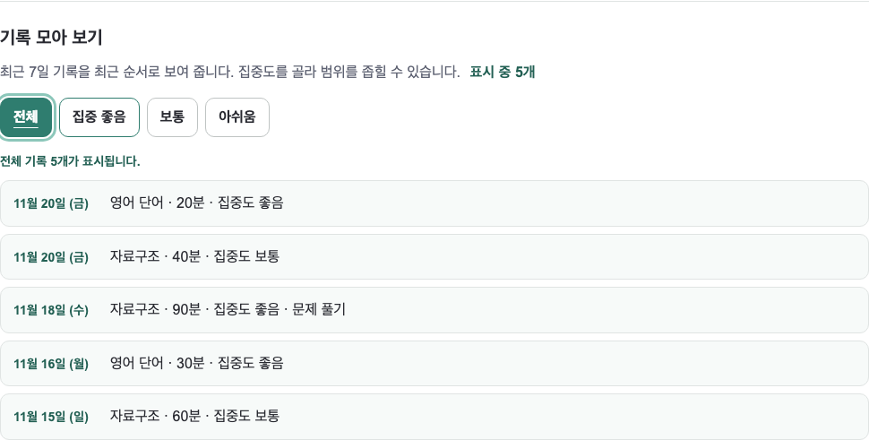 | 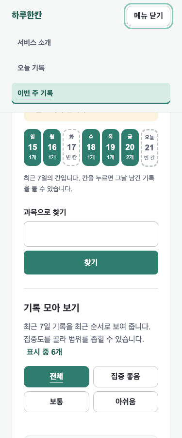 |

## 10주차 · 내비게이션 UI와 정보 탐색

사용자가 목적지를 찾고, 지금 어디에 있는지 알아보고, 저장한 기록을 조건에 따라 살펴보고,
작은 화면에서도 같은 경로를 쓸 수 있게 했습니다.

### Unit 01 · 목적지와 상단 메뉴

기존 메뉴는 섹션 다섯 개를 모두 나열했습니다. 사용자가 실제로 찾아가는 곳만 남겨,
**이해 → 기록 → 결과 확인** 순서의 세 메뉴로 줄였습니다.

| 메뉴 | 도착 영역 | 역할 |
| --- | --- | --- |
| 서비스 소개 | `#about` | 이용 안내 |
| 오늘 기록 | `#recordFlow` | 주요 행동 (과목·시간·집중도 기록) |
| 이번 주 기록 | `#weekBoard` | 결과 확인 (채운 칸, 기록 모아 보기) |

- 메뉴를 `ul > li > a` 목록으로 바꾸고 `#main-nav` 에 담았습니다.
- **상단 바를 `position: sticky` 로 고정했습니다.** 페이지가 길어서 메뉴가 화면 밖으로 사라지면 현재 위치 표시를 볼 수 없기 때문입니다. 메뉴로 이동한 영역의 제목이 바에 가려지지 않게 `scroll-margin-top: 80px` 을 두었습니다.
- `updateCurrentNav()` 가 주소의 `#` 값과 같은 메뉴 하나에만 `is-current` 와 `aria-current="page"` 를 남깁니다. `#` 이 없으면 첫 메뉴를 현재 위치로 봅니다. `hashchange` 에 연결해 뒤로 가기·앞으로 가기에도 강조가 따라갑니다.
- 현재 메뉴는 배경색과 아래 굵은 선을 함께 써서 색만으로 구분하지 않습니다.
- [이번 주 기록 보기], [새 기록 더하기], [오늘 기록 시작하기] 같은 버튼도 `goTo()` 로 메뉴와 같은 주소를 씁니다. 버튼으로 이동해도 메뉴 강조가 맞습니다.

**메뉴의 목적지가 항상 보이도록 바꾼 점.** 9주차까지 `오늘 기록` 은 안내 확인 뒤에, `이번 주 기록` 은 기록 완료 뒤에만 나타났습니다.
화면에 없는 곳을 메뉴에 넣을 수 없으므로 두 영역을 처음부터 보이게 했습니다.

- `오늘 기록` 은 안내를 확인하기 전에는 입력 form 대신 시작 조건과 [안내 확인하러 가기] 링크를 보여 줍니다. 6주차의 동의 조건은 그대로입니다.
- 안내를 확인하지 않은 채 이번 주 기록의 [새 기록 더하기]를 누르면 `오늘 기록` 으로 이동해 안내 링크에 초점을 둡니다. 조건을 건너뛰지 못합니다.

### Unit 02 · 저장 목록과 선택 범위

이번 주 기록 아래에 **기록 모아 보기** 목록을 추가했습니다. 저장된 기록에서 구분할 수 있는 상태로 **집중도**를 골랐습니다.
집중도는 모든 기록에 반드시 들어가는 값이라, 어느 기록도 필터에서 빠지지 않습니다.

- 필터 버튼은 `전체 / 집중 좋음 / 보통 / 아쉬움` 이며 `aria-pressed` 로 선택 상태를 전달합니다. 주소를 바꾸지 않으므로 링크가 아니라 `button` 입니다.
- `getVisibleRecords()` 가 필터에 맞는 기록을 최근 날짜 순으로 고르고, `renderRecordList()` 가 그 범위만 그립니다. 표시 중인 개수도 함께 바뀝니다.
- 목록의 기록을 누르면 그날 칸이 열려 자세한 기록과 지우기를 쓸 수 있습니다. 지우면 목록도 다시 계산됩니다.

| 결과 없음 상황 | 안내 | 행동 버튼 |
| --- | --- | --- |
| 고른 집중도의 기록이 없음 | "집중도 '아쉬움' 기록이 이번 주에 없어요. 다른 집중도를 선택하거나 [전체]를 눌러 모든 기록을 보세요." | 숨김 (다른 필터를 고르면 됨) |
| 기록이 하나도 없음 | "아직 남긴 기록이 없어요. 오늘 공부한 것을 기록하면 이곳에 한 줄씩 모입니다." | [오늘 기록하러 가기] |

### Unit 03 · 모바일 메뉴

- 600px 이하에서는 메뉴가 접히고 [메뉴 열기] 버튼이 나타납니다. 메뉴 이름·순서·`href` 는 그대로이고 보이는 방식만 바뀝니다.
- `setMenuOpen()` 하나가 메뉴의 `is-open`, 버튼 문구(메뉴 열기 / 메뉴 닫기), `aria-expanded` 를 같은 값으로 바꿉니다.
- 목적지를 누르면 메뉴가 닫힙니다. 교안에 더해 **Esc** 로도 닫고 초점을 메뉴 버튼으로 돌려줍니다.
- 메뉴 링크는 높이 44px 로 두어 손가락으로 누르기 쉽게 했습니다. 필터 버튼은 768px 이하에서 한 줄에 두 개씩 놓입니다.

### 10주차 테스트 결과

로컬 서버에서 실제 Chromium 으로 조작해 확인했습니다. (2026-11-08)

| 확인 경로 | 조작 | 결과 |
| --- | --- | --- |
| 첫 화면 | `#` 없이 열기 | `서비스 소개` 만 강조, `aria-current="page"` |
| 메뉴 이동 | 세 메뉴를 차례로 클릭 | 주소 `#recordFlow` · `#weekBoard` · `#about`, 강조 한 개, 영역 제목이 상단 바 바로 아래(80px)에 도착 |
| 뒤로·앞으로 | 뒤로 두 번, 앞으로 한 번 | 주소와 강조가 `이번 주 기록` → `오늘 기록` → `이번 주 기록` 으로 함께 이동 |
| 직접 주소 | `index.html#weekBoard` 로 열기 | `이번 주 기록` 강조 |
| 시작 조건 | 안내 확인 전 [새 기록 더하기] | `오늘 기록` 으로 이동, form 은 숨김, [안내 확인하러 가기]에 초점 |
| 기록 흐름 | 안내 확인 → 시작 → 자료구조 90분 아쉬움 저장 → [이번 주 기록 보기] | 주소·강조가 `오늘 기록` → `이번 주 기록`, 목록 맨 위에 오늘 기록, 7개 표시 |
| 필터 | 집중 좋음 / 아쉬움 | 3개 / 2개, 누른 버튼 하나만 `aria-pressed="true"` |
| 결과 없음 (필터) | 목록에서 아쉬움 기록 2개를 열어 지운 뒤 아쉬움 | 0개, 필터 결과 없음 안내, 행동 버튼 숨김 → 전체를 누르면 5개 복귀 |
| 결과 없음 (전체) | 기록을 모두 비움 | "아직 남긴 기록이 없어요." 와 [오늘 기록하러 가기] |
| 접힘 경계 | 601px / 600px | 601px 가로 메뉴·버튼 숨김 / 600px 메뉴 접힘·버튼 표시 |
| 모바일 메뉴 | 390px 에서 버튼 두 번 | 열림·"메뉴 닫기"·`true` → 닫힘·"메뉴 열기"·`false` |
| 목적지 선택 | 메뉴를 열고 `이번 주 기록` | 주소 `#weekBoard`, 메뉴 닫힘, 다시 열면 `이번 주 기록` 만 강조 |
| 키보드 | 메뉴 버튼에서 Tab 세 번 / Esc | 서비스 소개 → 오늘 기록 → 이번 주 기록 / 메뉴 닫히고 버튼에 초점 |
| 모바일 전체 흐름 | 390px 어두운 테마로 기록 저장 → 결과 확인 | 가로 스크롤 없음, 화면 밖 요소 0개 |
| 9주차 회귀 | 9주차 테스트 전체 다시 실행 | 검증·조건부 입력·저장 중·실패·초기화 모두 그대로 |
| Console | 전 경로 | 오류 없음 |

테스트 중 고친 문제: 상단 바 배경을 반투명(96%)으로 두었더니 모바일에서 메뉴를 열었을 때 뒤 본문 글자가 비쳐 메뉴 글자와 겹쳤습니다. 불투명 배경으로 바꿨습니다.

| 데스크톱 상단 메뉴 | 필터 (아쉬움) | 필터 결과 없음 |
| --- | --- | --- |
| 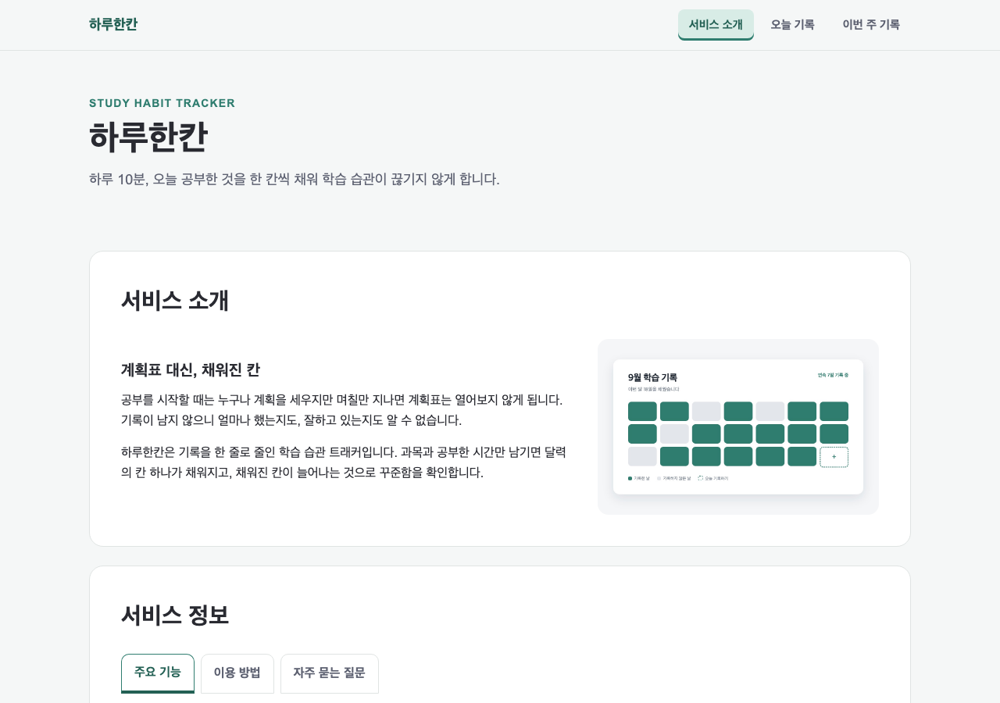 | 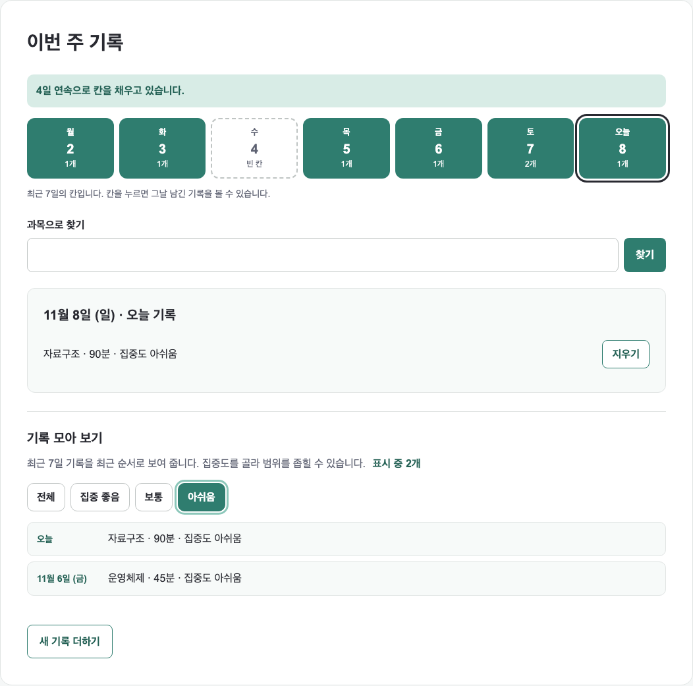 | 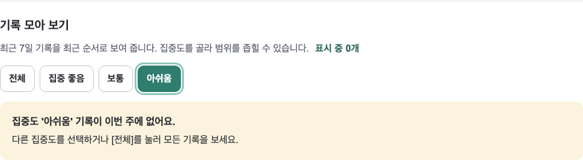 |

| 모바일 메뉴 닫힘 | 모바일 메뉴 열림 · 현재 위치 | 모바일 어두운 테마 · 보통 필터 |
| --- | --- | --- |
| 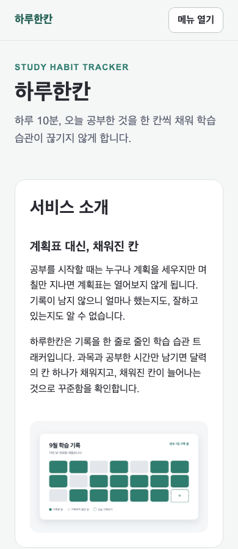 | 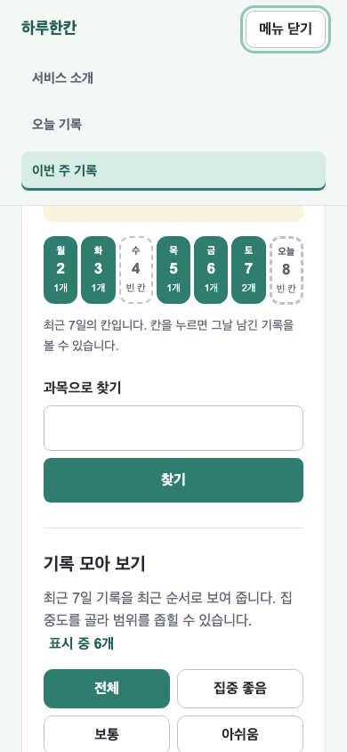 | 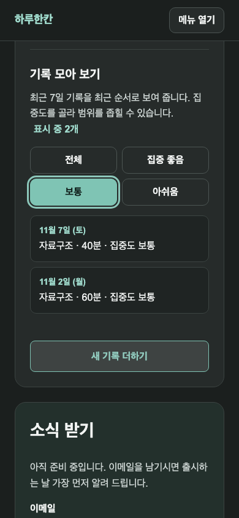 |

## 9주차 · 폼 UI와 입력 경험 설계

7주차의 3단계 기록 흐름을 유지하면서, 입력 화면을 **하나의 form** 으로 묶고
레이블·안내·오류·조건부 입력·제출 결과를 보완했습니다.
교수자 예시(Re:hear)의 원리를 하루한칸의 "오늘 기록 남기기" 에 옮겼습니다.

### 예시 코드와 내 서비스의 대응

| 확인할 역할 | Re:hear 예시 | 하루한칸 |
| --- | --- | --- |
| 전체 제출 범위 | `#plan-form` | `#recordForm` (1~3단계와 완료 화면을 감싸는 form) |
| 레이블·안내·오류·글자 수 | `#presentation-title` | `#recordSubject` 과목 (2~20자), `#recordMinutes` 시간 (1~1440분) |
| 조건부 입력 제어 | `#qna-option` | `#methodOption` "공부 방식도 함께 남길게요" 체크박스 |
| 표시·초점·제출 대상 | `#qna-options` | `#methodOptions` 강의 듣기 / 문제 풀기 / 복습·정리 라디오 |
| submit 과 중복 실행 방지 | `#save-plan` | `#recordComplete` [오늘 칸 채우기] (`type="submit"`) |
| 단계 제목과 오류 위치로 초점 이동 | `showStep()` | `showRecordStep()` |

**조건부 입력으로 공부 방식을 고른 이유.** 하루한칸의 기록은 과목·시간·집중도 세 가지로 충분하도록 일부러 줄였습니다.
공부 방식은 남기고 싶은 사람만 남기면 되는 정보라, 필수 칸으로 늘리지 않고 체크했을 때만 열리게 했습니다.
닫으면 라디오가 `disabled` 가 되어 Tab 순서와 `FormData` 에서 함께 빠집니다.

### 유닛 01 · 폼 UI 구조

- 1~3단계를 `<form id="recordForm" novalidate aria-busy="false">` 하나로 묶었습니다. 단계 이동 버튼은 `type="button"`, 최종 저장만 `type="submit"` 입니다.
- 모든 입력에 `name` 을 붙여 확인 화면과 저장 값을 `FormData` 로 읽습니다. 화면에 보이는 값과 저장되는 값이 어긋나지 않습니다.
- 과목·시간 칸은 `label for` ↔ `input id` 로 연결하고, 레이블 옆에 `필수` 표시를 두었습니다.
- 안내·글자 수·오류 문장을 각각 `p` 로 나누고 `aria-describedby="subject-help subject-count subject-error"` 로 입력칸에 연결했습니다. 7주차에는 두 칸이 오류 문장 하나(`#recordError`)를 같이 썼지만, 이제 칸마다 자기 오류를 바로 아래에 보여 줍니다.
- 공부 방식은 `fieldset` + `legend` 로 하나의 질문으로 묶고, 체크박스에 `aria-controls` · `aria-expanded` 를 두었습니다.

### 유닛 02 · 입력 경험

| 상태 | 화면 반응 |
| --- | --- |
| 기본 | 조건 안내("2자 이상 입력해 주세요")와 `0 / 20자` 가 처음부터 보입니다 |
| 초점 | 초록 테두리와 3px 포커스 링 |
| 작성 중 | 글자 수만 갱신합니다. 아직 검사 전이면 한 글자여도 빨간 오류를 띄우지 않습니다 |
| 조건 충족 | 초록 테두리 + "입력 조건을 충족했습니다." (시간은 "90분으로 기록합니다." 까지) |
| 오류 | 빨간 테두리 + 원인별 오류 문장. 오류가 확인된 칸은 값을 고치는 즉시 다시 검사합니다 |

- 오류 문장 자리(`min-height: 24px`)를 미리 비워 두어 오류가 생기고 사라질 때 아래 버튼이 흔들리지 않습니다.
- 단계가 바뀌면 새 단계의 제목(`h3`, `tabindex="-1"`)으로 초점을 옮깁니다. 진행 표시는 `aria-live` 로 함께 읽힙니다.

### 유닛 03 · 입력 검증과 피드백

원인이 다르면 오류 문장도 다르게 썼습니다.

| 입력 | 오류 문장 |
| --- | --- |
| 과목 빈 값 | 공부한 과목을 입력해 주세요. 예: 자료구조 |
| 과목 1자 | 과목 이름을 2자 이상 입력해 주세요. 예: 영어, 회계원리 |
| 시간 빈 값 | 공부한 시간을 입력해 주세요. 예: 90 |
| 시간 소수 | 시간은 분 단위 정수로 입력해 주세요. 예: 1시간 30분이면 90 |
| 시간 0 이하 | 공부한 시간을 1분 이상으로 입력해 주세요. 예: 10 |
| 시간 1440 초과 | 하루는 1440분입니다. 1440분 이하로 입력해 주세요. |

- `aria-invalid` · `.has-error` · 오류 문장을 `showFieldError()` / `clearFieldError()` 두 함수에서만 켜고 끕니다. 하나만 남는 일이 없습니다.
- 두 칸을 모두 검사해 오류를 한 번에 보여 주고, **첫 오류 칸**으로 초점을 옮깁니다.
- 확인 단계에서 저장할 때도 전체 값을 다시 검사합니다. 오류가 있으면 1단계를 열고 첫 오류 칸으로 갑니다.
- 1단계 입력칸에서 Enter 를 눌러도 [집중도 선택하기]와 같은 검증을 거칩니다. 저장은 버튼 click 이 아니라 form 의 `submit` 하나로 처리합니다.
- 저장 중에는 버튼을 `disabled` 로 잠그고 "칸을 채우는 중…" 으로 바꾸며, [집중도 수정하기]도 잠급니다. `isSaving` 으로 Enter 중복 제출도 막습니다.
- 저장은 0.6초 뒤 완료되는 흉내 함수(`persistRecord`)입니다. 주소에 `?save-error=1` 을 붙이면 실패 경로를 볼 수 있습니다.
- 실패하면 "저장하지 못했습니다. 입력한 내용은 그대로 두었습니다. [오늘 칸 채우기]를 다시 눌러 주세요." 를 빨간 배경으로 보여 주고, 입력값을 남긴 채 버튼을 다시 열어 초점을 둡니다.
- [다시 기록하기]·[새 기록 더하기]는 `form.reset()` 후 조건부 영역, 글자 수, 안내, 오류, 조건 충족 표시, 저장 문장, 버튼 문구까지 모두 처음으로 돌립니다.
- 이번 주 기록 보드에도 공부 방식이 함께 보입니다. 예: `자료구조 · 90분 · 집중도 아쉬움 · 복습·정리`

### 9주차 테스트 결과

로컬 서버에서 실제 Chromium 으로 조작해 확인했습니다. (2026-11-08)

| 확인 경로 | 조작 | 결과 |
| --- | --- | --- |
| 레이블 연결 | 과목·시간 레이블 클릭 | 각각 연결된 입력칸으로 초점 이동 |
| 단계 초점 | 기록 시작 / 1단계에서 Enter | "무엇을 공부했나요" / "오늘 집중은 어땠나요" 제목에 초점 |
| 작성 중 | 검사 전 한 글자 입력 | 오류 없음, `1 / 20자` |
| 빈 값 오류 | 빈 상태로 다음 | 두 칸 모두 오류 문장·빨간 테두리·`aria-invalid`, 초점은 과목 칸 |
| 실시간 재검사 | 오류 뒤 "자" → "자료구조" | 2자 오류 문장 → 오류 해제, 초록 테두리와 "입력 조건을 충족했습니다." |
| 시간 범위 | 2000 / 0 / 90 | 1440 초과 문장 / 1분 이상 문장 / 해제와 "90분으로 기록합니다." |
| 조건부 입력 닫힘 | 체크 안 함 | 영역 숨김, 라디오 3개 `disabled`, 체크박스 다음 Tab 이 [과목 수정하기], `FormData` 에 공부 방식 없음 |
| 조건부 입력 열림 | 체크 → 복습·정리 | Tab 이 라디오로 이동, `FormData` 에 `method=복습·정리` |
| 저장 중 | [오늘 칸 채우기] | 버튼·이전 버튼 잠금, "칸을 채우는 중…", `aria-busy="true"`, 이 사이 submit 두 번 더 → 기록은 1개만 저장 |
| 완료 | 저장 끝 | 완료 화면 제목에 초점, 이번 주 기록 오늘 칸에 공부 방식까지 표시 |
| 확인 단계 재검사 | 3단계에서 과목을 공백으로 바꾼 뒤 저장 | 1단계로 돌아가 과목 칸에 초점과 오류 |
| 실패 | `?save-error=1` 로 저장 | 실패 문장, 입력값·체크 상태 유지, 기록 수 변화 없음, 버튼 재활성화 → 다시 누르면 저장 중 상태로 진입 |
| 초기화 | 완료 후 [다시 기록하기] | 값·글자 수·안내·오류·조건 충족·조건부 영역·저장 문장·버튼 문구 모두 처음 상태 |
| 반응형 | 768px · 390px (어두운 테마) | 가로 스크롤 없음, 화면 밖 요소 0개, 체크박스·라디오는 18px 유지 |
| Console | 전 경로 | 오류 없음 |

테스트 중 고친 문제: 체크박스·라디오를 제외하려고 기본 입력 규칙에 `:not()` 을 두 번 붙였더니 선택자 우선순위가 올라가
**오류 칸의 빨간 테두리가 기본 테두리에 덮였습니다.** `:where(:not(...))` 로 감싸 우선순위를 올리지 않게 고쳤습니다.

| 기본 | 오류 | 조건 충족 |
| --- | --- | --- |
| 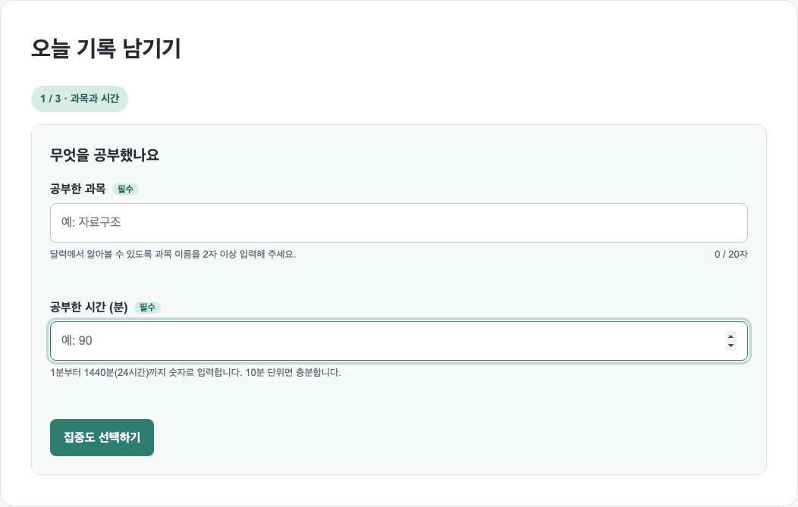 | 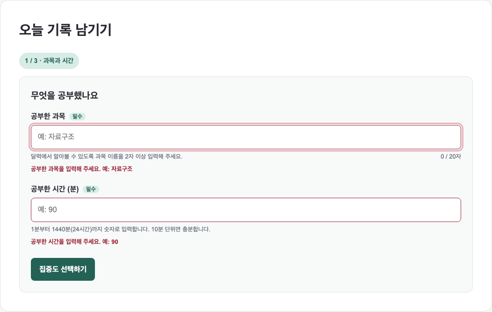 | 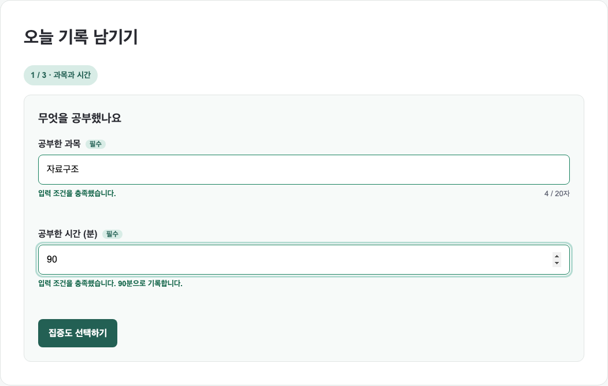 |

| 조건부 입력 | 저장 중 | 저장 실패 | 모바일 390px · 어두운 테마 |
| --- | --- | --- | --- |
| 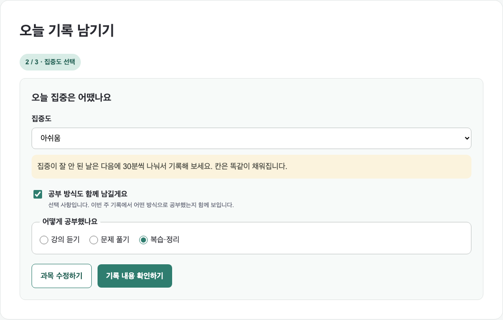 | 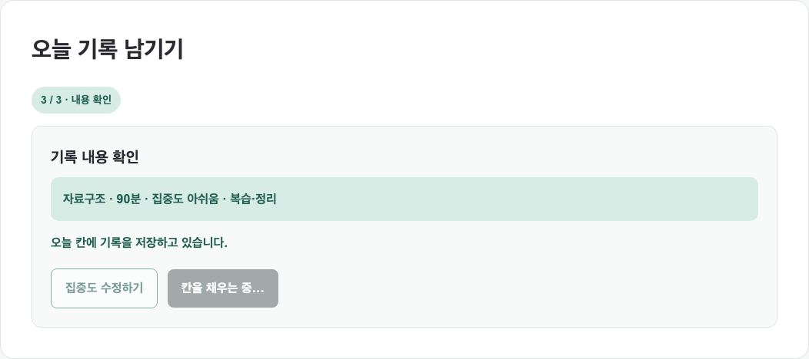 | 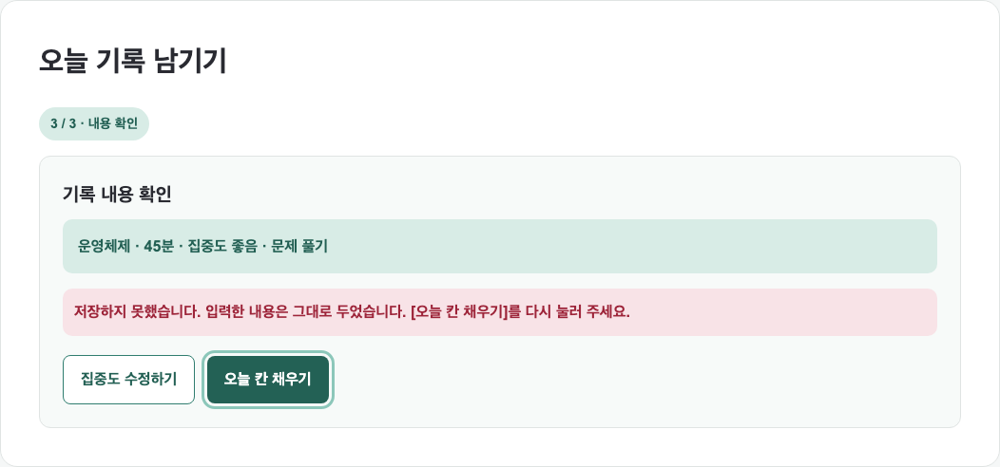 | 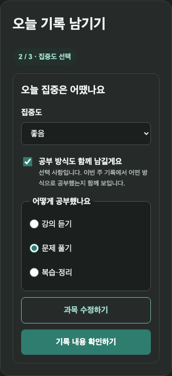 |

## 사용자와 목적

| 항목 | 내용 |
| --- | --- |
| 사용자 | 혼자 공부하지만 며칠 지나면 기록이 끊기는 대학생과 자격증 준비생 |
| 해결하려는 문제 | 계획은 세우지만 기록이 남지 않아 꾸준히 하고 있는지 알 수 없다 |
| 서비스 목적 | 공부의 양이 아니라 "매일 했다는 사실"을 눈으로 보여 준다 |
| 완료할 핵심 행동 | 오늘 공부한 과목·시간·집중도를 기록해 달력의 한 칸을 채운다 |
| 완료 조건 | 확인 화면에서 입력 내용을 검토하고 "오늘 칸을 채웠습니다" 화면에 도달한다 |

## 사용자 흐름

안내 확인을 마친 사용자만 기록 흐름에 들어갈 수 있습니다.
들어간 뒤에는 세 단계를 거쳐 완료 화면에 도착합니다.

```
이용 설정에서 안내 확인 (체크박스)
      ↓  확인해야 [오늘 기록 시작하기] 버튼이 눌립니다
1 / 3  과목과 시간   과목명과 공부한 시간(분)을 입력
      ↓  비어 있으면 넘어가지 않고 같은 단계에서 고칩니다
2 / 3  집중도 선택   좋음 / 보통 / 아쉬움 중 선택 (+ 원하면 공부 방식)
      ↓  [과목 수정하기] 로 1단계로 돌아갈 수 있습니다 (값 유지)
3 / 3  내용 확인     입력한 값을 한 줄로 검토
      ↓  [집중도 수정하기] 로 2단계로 돌아갈 수 있습니다
기록 완료            [다시 기록하기] 로 처음부터 다시 시작
      ↓  (중간고사) [이번 주 기록 보기]
이번 주 기록         채운 칸 확인 · 날짜별 기록 · 과목 찾기 · 지우기
```

가장 단순한 성공 경로를 먼저 만들고, 그 위에 빈 입력 → 안내 → 수정 경로와
이전 단계 → 값 유지 → 재확인 경로를 더했습니다. 화면 수를 늘리는 대신
지금 몇 번째 단계이고 무엇을 해야 하는지가 항상 보이도록 했습니다.

## 인터랙션 시나리오

| 행동 | 이벤트 · 조건 | 화면 반응과 다음 상태 |
| --- | --- | --- |
| 안내를 확인한다 | `change` · 체크됨 | 안내 문구가 완료 색으로 바뀌고 시작 버튼이 눌리는 상태가 된다 |
| 기록을 시작한다 | `click` · 동의 완료 | 기록 흐름이 열리고 1단계로 이동, 단계 제목에 포커스 (9주차) |
| 과목 없이 다음을 누른다 | `click` 또는 Enter(`submit`) · 과목이 비어 있음 | "공부한 과목을 입력해 주세요. 예: 자료구조" 를 과목 칸 아래에 보여 주고 빨갛게 표시한 뒤 같은 단계에 머문다 |
| 시간 없이 다음을 누른다 | `click` 또는 Enter · 시간이 비었거나 범위 밖 | 원인별 오류 문장(빈 값 / 1 미만 / 1440 초과 / 소수)을 시간 칸 아래에 보여 주고 첫 오류 칸으로 포커스를 옮긴다 |
| 공부 방식을 체크한다 | `change` · 체크됨 (9주차) | 방식 선택지가 열리고 선택 가능해진다. 해제하면 숨기고 `disabled` 로 제출에서도 뺀다 |
| 집중도를 아쉬움으로 바꾼다 | `change` · 값이 아쉬움 | "30분씩 나눠서 기록해 보세요" 안내를 추가로 보여 준다 |
| 확인 단계에서 이전을 누른다 | `click` · 수정 요청 | 입력값을 유지한 채 이전 단계로 돌아가고, 고친 값이 확인 화면에 다시 반영된다 |
| 기록을 완료한다 | `submit` · 전체 값 재검사 (9주차) | 저장 중 버튼 잠금 → 완료 화면으로 이동, 진행 표시가 "기록 완료" 로 바뀐다. 실패하면 입력값을 남기고 다시 시도 안내 |
| 다시 기록한다 | `click` · 초기화 | 입력·오류·선택·요약·진행 상태를 모두 비우고 1단계로 돌아간다 |

### 입력과 오류 처리 원칙

- 모든 입력창에 항상 보이는 레이블을 둡니다. 플레이스홀더로 이름을 대신하지 않습니다.
- 오류는 무엇이 잘못됐는지와 어떻게 고칠지를 함께 적고, 예시 값을 덧붙입니다.
- 오류가 난 칸으로 포커스를 옮겨 바로 고칠 수 있게 합니다.
- 오류 칸에 포커스가 가도 빨간 테두리가 초록 포커스 링에 가려지지 않게 했습니다.
- 오류 문구는 `role="alert"`, 진행 표시는 `aria-live="polite"` 로 변화를 읽어 줍니다.
- (9주차) 오류 문장은 칸마다 따로 두고 `aria-describedby` 로 그 칸에 연결합니다.

## 테스트 결과

브라우저에서 직접 조작해 확인한 결과입니다.

| 확인 경로 | 조작 | 결과 |
| --- | --- | --- |
| 진입 조건 | 동의 전·후에 시작 버튼을 누름 | 동의 전 `disabled`, 동의 후에만 흐름이 열림 |
| 정상 | 시작 → 입력 → 선택 → 확인 → 완료 | 네 단계가 끊김 없이 이어짐 |
| 빈 입력 (과목) | 과목 없이 다음 | 1단계에 머물고 과목 칸에 오류 표시 |
| 빈 입력 (시간) | 시간 없이 다음 | 1단계에 머물고 시간 칸에 오류 표시 |
| 이전·수정 | 90분 입력 후 확인 → 이전 → 120분으로 수정 | 값이 남아 있었고 요약이 `120분` 으로 갱신됨 |
| 다시 시작 | 완료 후 다시 기록하기 | 과목·시간·집중도·오류·요약·진행 표시가 모두 초기화 |
| 반응형 | 1100px · 768px · 390px | 가로 스크롤 0, 화면 밖으로 나간 요소 0, 각 단계 레이블 모두 보임 |
| Console | 로드와 전 경로 조작 | 오류 없음 |

확인 화면의 요약 문구는 `자료구조 · 120분 · 집중도 아쉬움` 형태로 만들어집니다.

## 화면 구성

| 영역 | 내용 |
| --- | --- |
| 탐색 | 서비스 이름, 세 개 이동 메뉴(현재 위치 강조). 901px 이상 왼쪽 고정 탐색과 [오늘 기록하기], 900px 이하 상단 바와 메뉴 버튼 (10·12주차) |
| 머리말 | 서비스 이름과 한 줄 소개 |
| 서비스 소개 | 해결하려는 문제와 학습 기록 달력 이미지 |
| 서비스 정보 | 탭 3개 — 주요 기능 / 이용 방법 / 자주 묻는 질문 |
| 알림 설정 | 알림 시간 저장과 저장 완료 피드백 |
| 이용 설정 | 어두운 테마 전환, 표시 이름 입력(글자 수), 안내 확인 체크 |
| 오늘 기록 남기기 | 안내 확인 후 열리는 3단계 기록 form (9주차: 칸별 안내·오류, 공부 방식 조건부 입력, 저장 중·실패 상태) |
| 이번 주 기록 | 최근 7일 칸, 연속 일수, 과목 찾기, 기록 지우기 (중간고사), 집중도로 거르는 기록 모아 보기 (10주차) |
| 소식 받기 | 출시 알림 이메일 신청 |

## 프로젝트 구조

```
uiuxprogramming/
├─ index.html
├─ style.css
├─ script.js
├─ README.md
├─ docs/            # 주차별 실행 화면 캡처
└─ assets/
   └─ images/
      └─ service.jpg
```

## 접근성에서 확인한 것

- 포커스 가능한 요소 전부에 `3px` outline 을 두어 키보드 위치가 보입니다.
- 밝은 테마와 어두운 테마의 색 조합을 모두 계산해 WCAG AA(4.5:1)를 넘겼습니다.
  (본문 14.94:1, 보조 문단 9.15:1, 활성 탭 7.16:1, 오류 문구 7.28:1)
- 탭은 `role="tab"` / `role="tabpanel"` 과 `aria-selected` 로 상태를 전달합니다.
- 비활성 버튼은 색만 흐리게 두지 않고 `disabled` 로 실제 조작을 막습니다.

---

# 부록 · 주차별 작업 기록

| 주차 | 한 일 | 남긴 판단 |
| --- | --- | --- |
| 1주차 | 기본 HTML 문서 구조와 제목·문단 작성 | 예시 문구 대신 내 서비스 내용으로 작성 |
| 2주차 | header·main·section·footer 시맨틱 구조, 목록, 이미지, 입력 영역, 내부 이동 | 기능은 순서가 없어 `ul`, 이용 방법은 순서가 의미를 가져 `ol` |
| 3주차 | style.css 연결, 정보 위계·그룹·배치·상태 피드백 | 강조색을 서비스 이미지에서 가져온 `#2f7d6f` 로 통일 |
| 4주차 | 유동 너비, 자동 Grid, 768px 미디어 쿼리 | 카드가 끝없이 좁아지는 Flexbox 대신 `auto-fit` Grid 로 열 수를 줄임 |
| 5주차 | script.js 연결, 알림 저장 클릭 피드백 | 문구·스타일·버튼 상태를 함께 바꿔야 저장을 확신할 수 있음 |
| 6주차 | click·input·change 이벤트, 탭 3개 | 기능과 이용 방법을 한 영역으로 묶어 탭으로 전환 |
| 7주차 | 다단계 기록 흐름, 검증·이전·완료·초기화 | 기존 동의 조건을 지우지 않고 새 흐름의 진입으로 연결 |
| 중간고사 | 이번 주 기록 보기 (칸 선택·과목 찾기·지우기 확인) | 기록 직후 성취감이 큰 순간에 채운 칸을 보여 주도록 흐름의 끝에 연결 |
| 9주차 | 기록 흐름을 form 으로 묶고 칸별 안내·오류, 조건부 입력, submit 저장 상태 구현 | 공부 방식은 필수로 늘리지 않고 원할 때만 열리는 조건부 입력으로 둠 |
| 10주차 | 세 메뉴와 현재 위치, 집중도 필터, 600px 이하 접히는 메뉴 | 메뉴를 다섯 개에서 세 개로 줄이고, 메뉴 목적지가 항상 보이도록 기록 영역의 숨김을 시작 조건 안내로 바꿈 |
| 11주차 | 선택 상태 밑줄, alt 수정, 탭 제목, 본문 바로가기, 필터 결과 알림, 전체 보기 복귀 | 그림 속 문구가 아니라 실제로 보이는 칸 수로 alt 를 고침 |
| 12주차 | 색 토큰, 버튼 공통 규칙, 선택 카드, 화면 폭별 탐색, 기록 카드 함수 | 글자와 hover 바탕에 함께 쓰이던 색을 다른 토큰으로 나눠 어두운 테마에서 대비가 깨지지 않게 함 |

### 4주차에 선택자 이름을 바꾼 이유

3주차에는 `.site-header`, `.site-nav`, `.feature-list` 를 썼지만 4주차 기준에 맞춰
`header`, `nav`, `.features-list` 로 바꿨습니다. 페이지에 `header`·`nav`·`footer` 가
각각 하나씩만 있어 요소 선택자로도 같은 결과가 나오고, 쓰지 않는 클래스가 남지 않습니다.

### 6주차에 기능 영역을 탭으로 바꾼 이유

`주요 기능`과 `이용 방법`이 각각 독립된 섹션이라 페이지를 계속 내려야 했습니다.
둘 다 "이 서비스가 무엇이고 어떻게 쓰는가"에 대한 답이므로 `서비스 정보` 한 영역으로
묶었습니다. 기존 기능 카드(4주차 자동 Grid)와 3단계 목록은 버리지 않고 각 패널로
옮겼고, 자주 묻는 질문만 새로 썼습니다.

### 고친 문제

- 768px 이하에서 체크박스가 가로로 늘어났습니다. 4주차의 `input, button { width: 100% }`
  가 체크박스까지 잡고 있어 `:not([type="checkbox"])` 로 제외했습니다.
- footer 글자색이 배경 위에서 4.13:1 로 기준에 못 미쳐 `#6b6e7c` 로 조정했습니다. (4.71:1)
- 오류 칸에 포커스가 가면 초록 포커스 링이 빨간 테두리를 덮었습니다.
  `.has-error:focus` 규칙을 따로 두어 오류 표시가 유지되게 했습니다.
