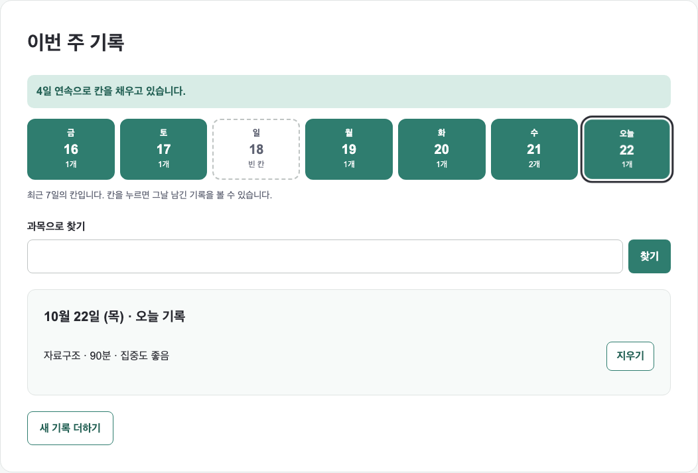
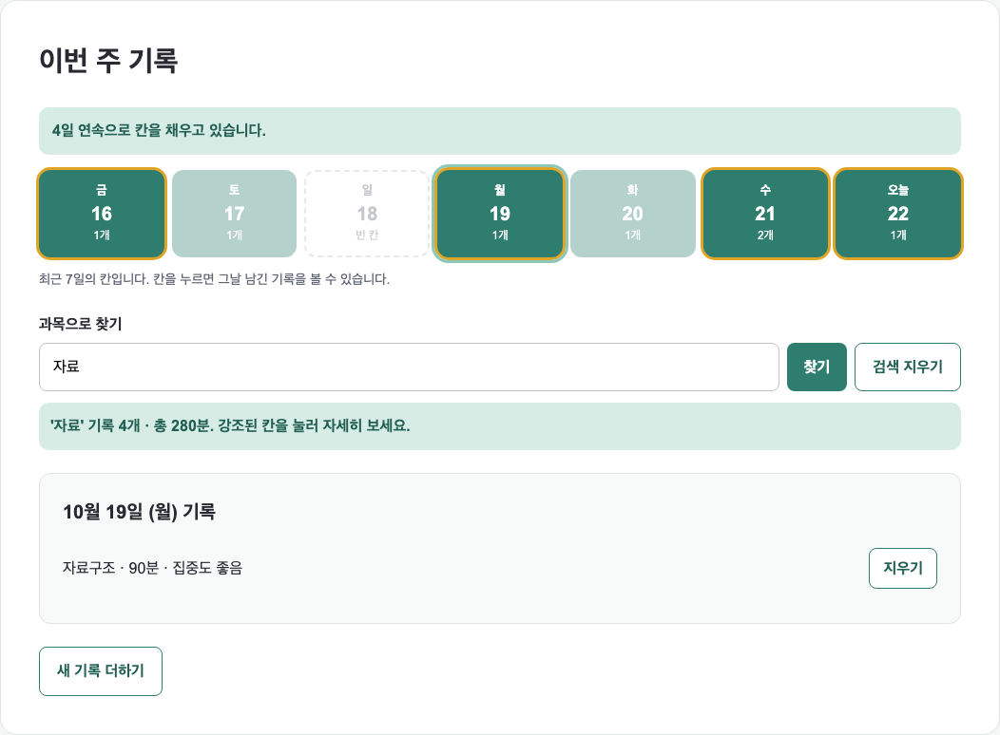
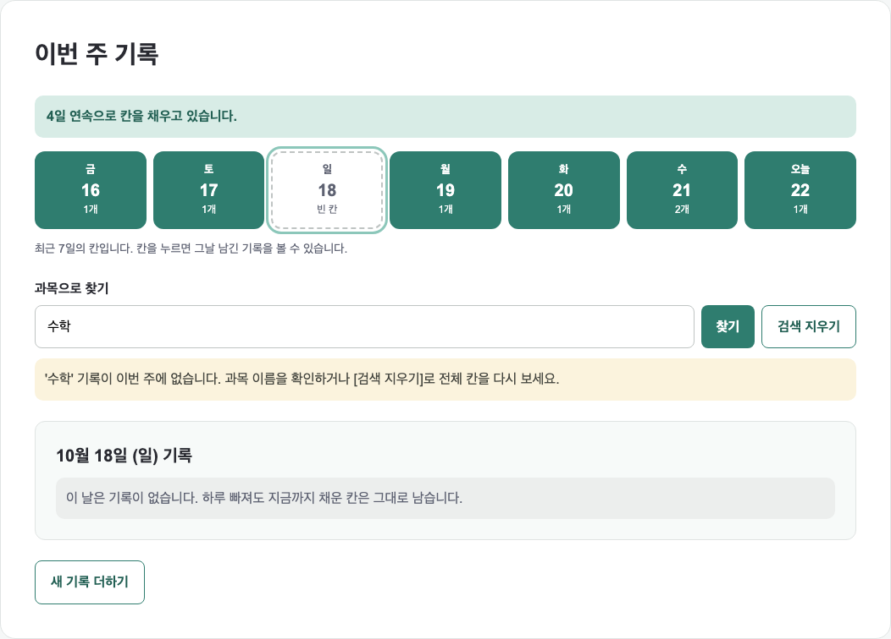
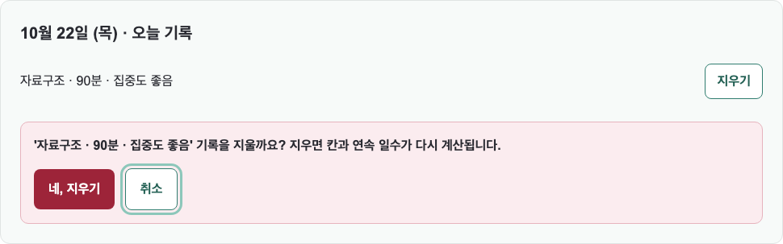
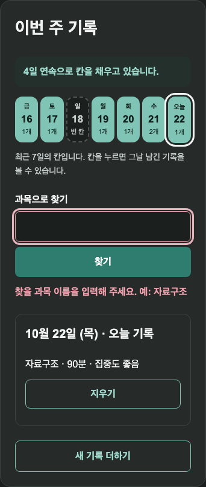

# 하루한칸

하루 10분, 오늘 공부한 것을 한 칸씩 채워 학습 습관이 끊기지 않게 하는 서비스의 소개 페이지입니다.

- 배포 주소: https://kimcumjee.github.io/uiuxprogramming/
- 저장소: https://github.com/kimcumjee/uiuxprogramming

## 중간고사 · 새로 추가한 기능: 이번 주 기록 보기

7주차 흐름의 끝인 기록 완료 화면에서 [이번 주 기록 보기]를 누르면 최근 7일 기록 칸과 연속 일수가 열립니다.
사용자는 방금 채운 오늘 칸을 확인한 뒤 날짜별 기록을 열어 보고, 과목으로 찾고, 잘못 남긴 기록을 지울 수 있습니다.

**왜 이 기능인가.** 이 서비스의 목적은 "매일 했다는 사실을 눈으로 보여 주는 것"입니다.
7주차에는 기록을 남기는 데서 흐름이 끝나 채운 칸을 볼 방법이 없었습니다.
기록 직후가 성취감이 가장 큰 순간이므로, 흐름의 **끝**에 이어 붙였습니다.

### 연결된 사용자 흐름

```
(7주차) 안내 확인 → 1 과목·시간 → 2 집중도 → 3 확인 → 기록 완료
                                                    ↓ [이번 주 기록 보기]
(새 경로) 이번 주 기록 ─ 최근 7일 칸 + 연속 일수, 오늘 칸이 채워지는 효과
            ├─ 칸 선택     → 그날 기록 목록 / 기록 없음 안내
            ├─ 과목으로 찾기 → 일치 칸 강조 + 합계 / 빈 값 오류 / 결과 없음
            ├─ 지우기      → 확인 상자 → [네, 지우기] 또는 [취소]
            └─ 새 기록 더하기 → 7주차 흐름을 초기화하고 1단계부터 다시 시작
```

### 사용자 행동 · 조건 · 반응

| 사용자 행동 | 이벤트 · 확인할 조건 | 성공 반응 | 다른 분기의 반응 | 다음 행동 |
| --- | --- | --- | --- | --- |
| 완료 화면에서 [이번 주 기록 보기] | `click` · 오늘 기록이 저장되었는가 | 7칸 보드가 열리고 오늘 칸이 채워지는 효과, "4일 연속으로 칸을 채우고 있습니다", 오늘 기록이 펼쳐짐 | 오늘 칸이 비어 있으면 "오늘 기록하면 N일 연속이 됩니다" 로 기다리는 색 표시 | 칸 선택, 과목 찾기 |
| 날짜 칸을 누른다 | `click` · 그날 기록이 있는가 | 그날 기록을 `과목 · 시간 · 집중도` 한 줄씩 보여 주고 각 줄에 [지우기] | **결과 없음:** "이 날은 기록이 없습니다. 하루 빠져도 지금까지 채운 칸은 그대로 남습니다." (오늘이면 [새 기록 더하기]로 안내) | 다른 칸 선택, 지우기 |
| 과목 이름을 넣고 [찾기] / Enter | `submit` · 값이 비었는가 → 일치하는 기록이 있는가 (대소문자 무시, 부분 일치) | 일치한 칸만 노란 테두리로 강조하고 나머지는 흐리게, "'자료' 기록 4개 · 총 280분" | **오류:** 빈 값이면 "찾을 과목 이름을 입력해 주세요. 예: 자료구조", 입력창 빨간 테두리와 포커스 / **결과 없음:** "'수학' 기록이 이번 주에 없습니다. 과목 이름을 확인하거나 [검색 지우기]…" | 강조된 칸 열기, [검색 지우기] |
| 검색창에 다시 입력한다 | `input` · 오류가 표시 중인가 | 오류 문구와 빨간 테두리를 지움 | — | 다시 찾기 |
| 기록 줄의 [지우기] | `click` · 바로 지우지 않고 확인 상자를 연다 | "'자료구조 · 90분 · 집중도 좋음' 기록을 지울까요?" 와 함께 포커스를 안전한 [취소]에 둠 | — | [네, 지우기] 또는 [취소] |
| [네, 지우기] | `click` · 확인 중인 기록이 있는가 | 기록을 지우고 칸·연속 일수·검색 결과를 다시 계산, "기록을 지웠습니다." | 오늘 기록을 지우면 연속 일수가 "오늘 칸이 비어 있습니다…" 로 바뀜 | 다른 칸 보기, 새 기록 더하기 |
| [취소] | `click` | — | **취소:** 확인 상자를 닫고 "지우기를 취소했습니다. 기록은 그대로 남아 있습니다." | 계속 보기 |
| [새 기록 더하기] | `click` | 7주차 흐름을 처음 상태로 초기화하고 1단계 과목 칸에 포커스 | 완료하면 보드가 열린 채로 오늘 칸이 바로 갱신됨 | 기록 남기기 |

### 상태 유지와 초기화

- 다른 칸을 열어도 **검색어와 강조는 유지**됩니다. 찾은 칸을 차례로 열어 볼 수 있습니다.
- 다른 칸을 열면 진행 중이던 지우기 확인은 닫힙니다. 다른 날 기록이 지워지는 실수를 막습니다.
- 검색 중에 기록을 지우면 남은 기록으로 검색 결과를 다시 계산합니다. 마지막 일치 기록을 지우면 결과 없음으로 바뀝니다.
- [새 기록 더하기]는 7주차의 [다시 기록하기]와 같은 `resetRecordFlow()` 함수를 써서 입력·오류·선택·진행 상태를 모두 비웁니다.
- 프로토타입이므로 지난 6일 기록은 예시 데이터이고, 4일 전은 일부러 비워 연속 일수가 끊기는 경우를 볼 수 있게 했습니다. 새로고침하면 예시 상태로 돌아갑니다.

### 코드에서 바꾼 곳

| 파일 | 내용 |
| --- | --- |
| `index.html` | 완료 화면에 [이번 주 기록 보기] 버튼, `#weekBoard` 섹션(연속 일수, 7칸 목록, 검색 폼, 날짜 상세, 지우기 확인 상자) 추가 |
| `style.css` | 칸 상태 클래스(`is-filled` · `is-today` · `is-selected` · `is-match` · `just-filled`), 검색 메시지 상태(`is-error` · `is-empty` · `is-found`), 위험 버튼, 어두운 테마, 768px 이하 배치 |
| `script.js` | 완료 시 `saveTodayRecord()` 로 기록 저장, 다시 시작을 `resetRecordFlow()` 함수로 분리, 칸 그리기·연속 일수·검색·지우기 확인 로직 추가 |

HTML 은 빈 구조만 두고, 칸과 기록 목록은 JavaScript 가 데이터로 다시 그리며, 보이는 모양은 CSS 클래스가 담당합니다.
사용자가 입력한 과목명은 `innerHTML` 이 아니라 `textContent` 로 넣었습니다.

### 접근성

- 각 칸은 `button` 이고 `aria-label` 로 "10월 21일 (수), 기록 2개, 찾은 과목 있음" 처럼 읽힙니다. 선택 상태는 `aria-pressed` 로 전달합니다.
- 칸을 다시 그린 뒤에도 누른 칸으로 포커스를 되돌려 키보드 위치를 잃지 않게 했습니다.
- 연속 일수·검색 결과·지우기 결과는 `aria-live="polite"` 로 읽힙니다.
- 오늘 칸 강조 효과는 `prefers-reduced-motion` 에서 끕니다.

### 중간고사 테스트 결과

로컬 서버에서 실제 브라우저로 조작해 확인했습니다. (2026-10-22)

| 확인 경로 | 조작 | 결과 |
| --- | --- | --- |
| 정상 | 안내 확인 → 자료구조 90분 → 완료 → 이번 주 기록 보기 | 오늘 칸 `기록 1개` 로 채워짐, "4일 연속으로 칸을 채우고 있습니다", 오늘 기록 펼쳐짐 |
| 결과 없음 (날짜) | 4일 전 빈 칸 선택 | "이 날은 기록이 없습니다…" 표시, 포커스는 누른 칸에 유지 |
| 오류 (검색) | 공백만 넣고 찾기 | 오류 문구, 입력창 빨간 테두리, 입력창으로 포커스 → 다시 입력하면 오류 해제 |
| 결과 없음 (검색) | `수학` 찾기 | 결과 없음 안내와 [검색 지우기] 표시, 칸은 흐려지지 않음 |
| 성공 (검색) | `자료` 찾기 → 다른 칸 선택 | 4칸 강조, "기록 4개 · 총 280분", 칸을 옮겨도 검색 유지 |
| 취소 | 오늘 기록 [지우기] → [취소] | 확인 상자가 닫히고 기록 1개 그대로, 취소 안내 표시 |
| 삭제 | 오늘 기록 [지우기] → [네, 지우기] | 오늘 칸이 빈 칸으로, 연속 일수 "오늘 기록하면 4일 연속이 됩니다", 검색 결과 3개 · 190분으로 재계산 |
| 다시 시작 | [새 기록 더하기] → 영어 30분 완료 | 1단계·빈 입력으로 초기화, 완료 즉시 오늘 칸과 연속 일수 갱신 |
| 반응형 | 1280px · 768px · 390px 에서 같은 경로 | 가로 스크롤 없음, 화면 밖으로 나간 요소 0개, 7칸이 한 줄 유지, 검색 버튼은 모바일에서 세로 배치 |
| Console | 로드와 전 경로 조작 | 오류 없음 |

테스트 중 고친 문제: 지우기 후 새 기록을 완료하면 "기록을 지웠습니다" 문구가 남아 있어, 기록 저장 시 이전 안내를 지우도록 수정했습니다.

| 기록 보드 | 과목 검색 | 결과 없음 |
| --- | --- | --- |
|  |  |  |

| 지우기 확인 | 모바일 390px · 어두운 테마 · 빈 검색 오류 |
| --- | --- |
|  |  |

## 사용자와 목적

| 항목 | 내용 |
| --- | --- |
| 사용자 | 혼자 공부하지만 며칠 지나면 기록이 끊기는 대학생과 자격증 준비생 |
| 해결하려는 문제 | 계획은 세우지만 기록이 남지 않아 꾸준히 하고 있는지 알 수 없다 |
| 서비스 목적 | 공부의 양이 아니라 "매일 했다는 사실"을 눈으로 보여 준다 |
| 완료할 핵심 행동 | 오늘 공부한 과목·시간·집중도를 기록해 달력의 한 칸을 채운다 |
| 완료 조건 | 확인 화면에서 입력 내용을 검토하고 "오늘 칸을 채웠습니다" 화면에 도달한다 |

## 사용자 흐름

안내 확인을 마친 사용자만 기록 흐름에 들어갈 수 있습니다.
들어간 뒤에는 세 단계를 거쳐 완료 화면에 도착합니다.

```
이용 설정에서 안내 확인 (체크박스)
      ↓  확인해야 [오늘 기록 시작하기] 버튼이 눌립니다
1 / 3  과목과 시간   과목명과 공부한 시간(분)을 입력
      ↓  비어 있으면 넘어가지 않고 같은 단계에서 고칩니다
2 / 3  집중도 선택   좋음 / 보통 / 아쉬움 중 선택
      ↓  [과목 수정하기] 로 1단계로 돌아갈 수 있습니다 (값 유지)
3 / 3  내용 확인     입력한 값을 한 줄로 검토
      ↓  [집중도 수정하기] 로 2단계로 돌아갈 수 있습니다
기록 완료            [다시 기록하기] 로 처음부터 다시 시작
      ↓  (중간고사) [이번 주 기록 보기]
이번 주 기록         채운 칸 확인 · 날짜별 기록 · 과목 찾기 · 지우기
```

가장 단순한 성공 경로를 먼저 만들고, 그 위에 빈 입력 → 안내 → 수정 경로와
이전 단계 → 값 유지 → 재확인 경로를 더했습니다. 화면 수를 늘리는 대신
지금 몇 번째 단계이고 무엇을 해야 하는지가 항상 보이도록 했습니다.

## 인터랙션 시나리오

| 행동 | 이벤트 · 조건 | 화면 반응과 다음 상태 |
| --- | --- | --- |
| 안내를 확인한다 | `change` · 체크됨 | 안내 문구가 완료 색으로 바뀌고 시작 버튼이 눌리는 상태가 된다 |
| 기록을 시작한다 | `click` · 동의 완료 | 기록 흐름이 열리고 1단계로 이동, 과목 입력창에 포커스 |
| 과목 없이 다음을 누른다 | `click` · 과목이 비어 있음 | "공부한 과목을 입력해 주세요. 예: 자료구조" 를 보여 주고 과목 칸을 빨갛게 표시한 뒤 같은 단계에 머문다 |
| 시간 없이 다음을 누른다 | `click` · 시간이 비었거나 1 미만 | "공부한 시간을 1분 이상 숫자로 입력해 주세요. 예: 90" 을 보여 주고 시간 칸으로 포커스를 옮긴다 |
| 집중도를 아쉬움으로 바꾼다 | `change` · 값이 아쉬움 | "30분씩 나눠서 기록해 보세요" 안내를 추가로 보여 준다 |
| 확인 단계에서 이전을 누른다 | `click` · 수정 요청 | 입력값을 유지한 채 이전 단계로 돌아가고, 고친 값이 확인 화면에 다시 반영된다 |
| 기록을 완료한다 | `click` · 확인 완료 | 완료 화면으로 이동하고 진행 표시가 "기록 완료" 로 바뀐다 |
| 다시 기록한다 | `click` · 초기화 | 입력·오류·선택·요약·진행 상태를 모두 비우고 1단계로 돌아간다 |

### 입력과 오류 처리 원칙

- 모든 입력창에 항상 보이는 레이블을 둡니다. 플레이스홀더로 이름을 대신하지 않습니다.
- 오류는 무엇이 잘못됐는지와 어떻게 고칠지를 함께 적고, 예시 값을 덧붙입니다.
- 오류가 난 칸으로 포커스를 옮겨 바로 고칠 수 있게 합니다.
- 오류 칸에 포커스가 가도 빨간 테두리가 초록 포커스 링에 가려지지 않게 했습니다.
- 오류 문구는 `role="alert"`, 진행 표시는 `aria-live="polite"` 로 변화를 읽어 줍니다.

## 테스트 결과

브라우저에서 직접 조작해 확인한 결과입니다.

| 확인 경로 | 조작 | 결과 |
| --- | --- | --- |
| 진입 조건 | 동의 전·후에 시작 버튼을 누름 | 동의 전 `disabled`, 동의 후에만 흐름이 열림 |
| 정상 | 시작 → 입력 → 선택 → 확인 → 완료 | 네 단계가 끊김 없이 이어짐 |
| 빈 입력 (과목) | 과목 없이 다음 | 1단계에 머물고 과목 칸에 오류 표시 |
| 빈 입력 (시간) | 시간 없이 다음 | 1단계에 머물고 시간 칸에 오류 표시 |
| 이전·수정 | 90분 입력 후 확인 → 이전 → 120분으로 수정 | 값이 남아 있었고 요약이 `120분` 으로 갱신됨 |
| 다시 시작 | 완료 후 다시 기록하기 | 과목·시간·집중도·오류·요약·진행 표시가 모두 초기화 |
| 반응형 | 1100px · 768px · 390px | 가로 스크롤 0, 화면 밖으로 나간 요소 0, 각 단계 레이블 모두 보임 |
| Console | 로드와 전 경로 조작 | 오류 없음 |

확인 화면의 요약 문구는 `자료구조 · 120분 · 집중도 아쉬움` 형태로 만들어집니다.

## 화면 구성

| 영역 | 내용 |
| --- | --- |
| 머리말 | 서비스 이름, 한 줄 소개, 다섯 개 이동 메뉴 |
| 서비스 소개 | 해결하려는 문제와 학습 기록 달력 이미지 |
| 서비스 정보 | 탭 3개 — 주요 기능 / 이용 방법 / 자주 묻는 질문 |
| 알림 설정 | 알림 시간 저장과 저장 완료 피드백 |
| 이용 설정 | 어두운 테마 전환, 표시 이름 입력(글자 수), 안내 확인 체크 |
| 오늘 기록 남기기 | 안내 확인 후 열리는 3단계 기록 흐름 |
| 이번 주 기록 | 기록 완료 후 열리는 최근 7일 칸, 연속 일수, 과목 찾기, 기록 지우기 (중간고사) |
| 소식 받기 | 출시 알림 이메일 신청 |

## 프로젝트 구조

```
uiuxprogramming/
├─ index.html
├─ style.css
├─ script.js
├─ README.md
├─ docs/            # 주차별 실행 화면 캡처
└─ assets/
   └─ images/
      └─ service.jpg
```

## 접근성에서 확인한 것

- 포커스 가능한 요소 전부에 `3px` outline 을 두어 키보드 위치가 보입니다.
- 밝은 테마와 어두운 테마의 색 조합을 모두 계산해 WCAG AA(4.5:1)를 넘겼습니다.
  (본문 14.94:1, 보조 문단 9.15:1, 활성 탭 7.16:1, 오류 문구 7.28:1)
- 탭은 `role="tab"` / `role="tabpanel"` 과 `aria-selected` 로 상태를 전달합니다.
- 비활성 버튼은 색만 흐리게 두지 않고 `disabled` 로 실제 조작을 막습니다.

---

# 부록 · 주차별 작업 기록

| 주차 | 한 일 | 남긴 판단 |
| --- | --- | --- |
| 1주차 | 기본 HTML 문서 구조와 제목·문단 작성 | 예시 문구 대신 내 서비스 내용으로 작성 |
| 2주차 | header·main·section·footer 시맨틱 구조, 목록, 이미지, 입력 영역, 내부 이동 | 기능은 순서가 없어 `ul`, 이용 방법은 순서가 의미를 가져 `ol` |
| 3주차 | style.css 연결, 정보 위계·그룹·배치·상태 피드백 | 강조색을 서비스 이미지에서 가져온 `#2f7d6f` 로 통일 |
| 4주차 | 유동 너비, 자동 Grid, 768px 미디어 쿼리 | 카드가 끝없이 좁아지는 Flexbox 대신 `auto-fit` Grid 로 열 수를 줄임 |
| 5주차 | script.js 연결, 알림 저장 클릭 피드백 | 문구·스타일·버튼 상태를 함께 바꿔야 저장을 확신할 수 있음 |
| 6주차 | click·input·change 이벤트, 탭 3개 | 기능과 이용 방법을 한 영역으로 묶어 탭으로 전환 |
| 7주차 | 다단계 기록 흐름, 검증·이전·완료·초기화 | 기존 동의 조건을 지우지 않고 새 흐름의 진입으로 연결 |
| 중간고사 | 이번 주 기록 보기 (칸 선택·과목 찾기·지우기 확인) | 기록 직후 성취감이 큰 순간에 채운 칸을 보여 주도록 흐름의 끝에 연결 |

### 4주차에 선택자 이름을 바꾼 이유

3주차에는 `.site-header`, `.site-nav`, `.feature-list` 를 썼지만 4주차 기준에 맞춰
`header`, `nav`, `.features-list` 로 바꿨습니다. 페이지에 `header`·`nav`·`footer` 가
각각 하나씩만 있어 요소 선택자로도 같은 결과가 나오고, 쓰지 않는 클래스가 남지 않습니다.

### 6주차에 기능 영역을 탭으로 바꾼 이유

`주요 기능`과 `이용 방법`이 각각 독립된 섹션이라 페이지를 계속 내려야 했습니다.
둘 다 "이 서비스가 무엇이고 어떻게 쓰는가"에 대한 답이므로 `서비스 정보` 한 영역으로
묶었습니다. 기존 기능 카드(4주차 자동 Grid)와 3단계 목록은 버리지 않고 각 패널로
옮겼고, 자주 묻는 질문만 새로 썼습니다.

### 고친 문제

- 768px 이하에서 체크박스가 가로로 늘어났습니다. 4주차의 `input, button { width: 100% }`
  가 체크박스까지 잡고 있어 `:not([type="checkbox"])` 로 제외했습니다.
- footer 글자색이 배경 위에서 4.13:1 로 기준에 못 미쳐 `#6b6e7c` 로 조정했습니다. (4.71:1)
- 오류 칸에 포커스가 가면 초록 포커스 링이 빨간 테두리를 덮었습니다.
  `.has-error:focus` 규칙을 따로 두어 오류 표시가 유지되게 했습니다.
